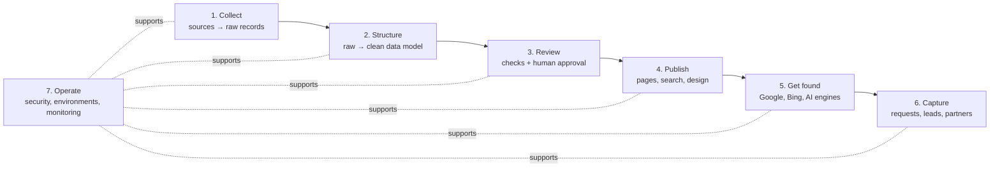

# Clerikaa: Product and Engineering Plan

> **Living document.** Last updated: **2026-10-31**. Owner: rajjys.
> This file is the single source of truth for where the project is going, what is done, and what comes next.
> Anyone joining the project should be able to read it top to bottom and know what to work on.

---

## How to use this plan

**Status legend:** ✅ done · 🟡 in progress · ⬜ not started · ⏸ on hold · ❓ needs a decision

**Rules**
1. Every work item has an ID (e.g. `C-2`). Reference it in PR titles and commit messages so progress is traceable.
2. A PR that finishes an item updates its status here in the same PR.
3. Every product or technical decision goes in the [Decision log](#8-decision-log) with its date and reason. Decisions are not re-opened without new facts.
4. Facts in this plan are verified against a source. When something is an assumption, it says so.

**Detailed documents** (index: [docs/README.md](README.md))
- [ROUTE-MODEL.md](ROUTE-MODEL.md): route-centric data model, back office and build phases RW-1 → RW-7
- [DESIGN-SYSTEM.md](DESIGN-SYSTEM.md): brand, tokens, components, data display rules
- [SEO-AEO-GEO.md](SEO-AEO-GEO.md): binding rules for public pages, search engines and AI engines
- [DATA-SOURCES.md](DATA-SOURCES.md): sources, OAG/Cirium, airline systems and the partnership plan

**Contents**
1. [The problem](#1-the-problem)
2. [The product](#2-the-product)
3. [Business path](#3-business-path)
4. [Principles](#4-principles)
5. [Where we are today](#5-where-we-are-today)
6. [The pipeline: seven stages](#6-the-pipeline-seven-stages)
7. [Milestones](#7-milestones)
8. [Decision log](#8-decision-log)
9. [Waiting on](#9-waiting-on)
10. [Risks](#10-risks)
11. [Glossary](#11-glossary)

---

## 1. The problem

In the DRC, finding out **which airline flies a domestic route, on which days, at what time and for roughly what price** is hard:

- Airline websites are difficult to use, and some booking engines only show results after a full search.
- Travellers call the airline or a travel agency. Some agents hide flights from airlines that don't pay them a commission ("there is no flight today").
- Global travel sites (eDreams, Kayak, Jetcost, rome2rio…) rank on Google for these searches, but give template pages:
  - prices in EUR, or monthly averages
  - airlines that are grounded (Congo Airways has not flown since April 2025)
  - airports that are closed (Goma has been closed since January 2025)
- Nobody publishes **dated, sourced, route-by-route** information for DRC domestic flights.

## 2. The product

**What it is:** an informational website for DRC domestic flights. For each route it shows:
- the airlines operating it and the days they fly
- departure and arrival times (local)
- an **indicative price** with the date it was observed and its source
- the current status of airports and airlines (closed, suspended, operating)

**What it is not (for now):** an airline, a ticket seller, or a booking engine. Prices are indicative; the airline or an agency confirms the final fare.

**Who it serves**
1. **Travellers** who want to compare before calling anyone.
2. **Travel agencies** later: as a lead source first, then as a product they license for their own website.
3. **Search engines and AI assistants**, which need a reliable, citable source for DRC flight questions.

**Scope today:** domestic DRC routes · prices in USD · French first, English second.

## 3. Business path

Each step only starts when the previous one shows value.

| Step | What we do | What it proves | Status |
|---|---|---|---|
| 1. Intent capture | Rank on Google for searches like "prix kinshasa kalemie caa". Answer them with accurate data. | People want this and find us. | 🟡 building |
| 2. Leads | Travellers send flight requests. We pass them to partner agencies and earn a commission. | The traffic has commercial value. | ⬜ |
| 3. Licensing | An agency uses the platform to power its own website (white-label). | The software itself has value. | ⬜ |
| 4. Official data | With an agency partner (and its licences), request direct data feeds or APIs from airlines. | Data quality at scale. | ⬜ |

## 4. Principles

These rules decide every trade-off. If a task breaks one of them, the task changes.

1. **Accuracy over coverage.** Every price and schedule shows *when* it was checked and *where* it came from. Unverified data is not published.
2. **Only publish pages that have real data.** No auto-generated pages for routes nobody flies (see [Risks](#10-risks), Google spam policies).
3. **Automate collection, a human approves publication.** One person runs this project, so machines do the repetitive work. Nothing reaches the public site without passing the review step.
4. **Collect data legally and politely.** Respect robots.txt and terms of use. Never bypass bot protection. When a source says no, we ask for permission instead.
5. **Zero budget until there is revenue.** Free tiers only. Any paid service needs a decision in the log.
6. **Mobile-first, low-bandwidth.** Most users are on Android phones with slow or expensive data.
7. **No personal data leaks.** Admin areas stay behind login; customer data is never exposed by the public API.

## 5. Where we are today

Snapshot on **2026-10-31**:

| Area | State |
|---|---|
| Security | ✅ Admin login, all write APIs protected, Next.js upgraded (4 critical vulnerabilities fixed), customer data no longer public. Deployed and verified in production (PR #1). |
| Data model | ✅ Schema v3, route-centric, in production (**RW-1**, PR #8, 2026-10-31): routes with status and priority, airlines on routes, flights on dates, change history ([ROUTE-MODEL.md](ROUTE-MODEL.md)). |
| Data | ⚠️ **Production:** reference data loaded by the owner on 2026-10-31 (checked on the live API: 17 airports with correct timezones, Goma and Bunia closed, Congo Airways suspended); the owner ran the seed again after RW-1, which adds the 34 priority routes. The old data (30 schedules expired on 2026-02-28, 30 prices copied from them) is still there: the clean-up script is ready (see [Waiting on](#9-waiting-on)). The public site shows no flights until the route workspace is used. **Local only:** preview data typed in from CAA's 20 Oct 2026 timetable and Air Congo's schedule PDF: 82 schedules for today's search, and 832 flights on dates (20 Oct → 29 Nov, 46 airline-on-route records) for the route back office. |
| Brand and design | ✅ **Clerikaa** in code (still served from `lebourgeois.cd`). Design system v1 merged (PR #5): tokens, font, logo, components, `/dashboard/design`. |
| Public site | 🟡 Home rebuilt and rendered on the server (P-9, PR #6). Navbar search button, contact page and form fixes live (P-12, PR #7). Search, flight detail and request pages are still rendered in the browser until RW-5. |
| Leads | 🟡 Request form and contact form save to the database; both are visible in the back office (Demandes, Messages). Email alerts are built but on hold. |
| Environments | ✅ Separate local dev database. Production migrations run automatically on deploy. |

---

## 6. The pipeline: seven stages

The product is a pipeline. Data enters at stage 1 and reaches people at stages 4–6. Each stage has:
- an **input** and an **output**
- **quality metrics**
- **improvement levers**

As long as a stage keeps producing the output the next stage expects, it can be improved on its own without touching the others.

### Stage 1: Collect

**Purpose:** get schedules, prices and statuses from the outside world into our system.
**Input:** external sources. **Output:** raw records with source URL and date, waiting for review.

#### The three collection levels
These are the original three approaches. They **run side by side**; a higher level does not replace a lower one.

| Level | How | Strength | Weakness | Status |
|---|---|---|---|---|
| **L1: Manual** | The operator manages each route in the back office (from airline sites, timetables, phone calls, agencies). | Works for any airline, any route. Most trustworthy today. | Depends on one person; needs good tools. | 🟡 **priority**: the route workspace (RW-1 → RW-4) makes it fast |
| **L2: Automated collection** | Daily jobs read **public, allowed** sources (timetable PDFs, airline homepages) and propose records for review. | Fresh and cheap. | Breaks when a website changes; legal grey zone. | ⏸ **paused**: owner decision, manual first (C-2, C-3) |
| **L3: Official feeds** | Airline data feeds or APIs under an agreement. | Most accurate; includes live fares. | Needs permission, usually an agency/IATA partner. | ⬜ **next after the first live routes**: partnerships (C-7), see [DATA-SOURCES.md](DATA-SOURCES.md#5-partnership-plan) |

**Trust order when sources disagree:** L3 official feed > airline timetable > airline website > manual entry > traveller report.

#### Source register
Verified on 2026-10-30.

| Source | Gives | Allowed? | Freshness | Use |
|---|---|---|---|---|
| CAA weekly timetable PDF (`caacongo.com/horaires.html` → PDF) | Flight numbers, days, local times, block times, aircraft | ✅ robots.txt allows (10 s crawl delay) | Weekly; file valid from 20/10/2026, updated 26/10/2026 | **L2 importer (C-2)** |
| Air Congo homepage "From USD" fares | Lowest advertised fare per destination | ✅ no robots.txt, no terms found | Read 30/10/2026; origin not stated (Kinshasa assumed, needs review) | L2 reader (C-3); 5 fares already recorded as pending |
| Air Congo schedule PDF | Routes, days, times (no flight numbers) | ✅ | Stale (created 22/04/2025) | Reference only |
| CAA booking engine (Videcom) | Live fares and seats | ❌ robots.txt `Disallow: /` | n/a | **Do not use** without written permission |
| Air Congo booking (Ethiopian Sabre DX) | Live fares | ❌ behind Akamai + Imperva bot protection | n/a | **Do not use** |
| Amadeus Self-Service API | n/a | ❌ shut down July 2026 | n/a | Rejected |
| Duffel API | n/a | ❌ contract §2.5(d) bans metasearch; carries no DRC domestic airline | n/a | Rejected |
| OAG / Cirium | Schedules (Cirium carries both CAA and Air Congo; OAG unverified) | ❌ no free licence allows publishing; both forbid resale | n/a | **Not now** ([DATA-SOURCES.md §2](DATA-SOURCES.md#2-oag-and-cirium-can-they-help)) |
| AeroDataBox | Schedules, 68% coverage for Kinshasa | ✅ on paid plans (about $7.50/month) | n/a | Optional cross-check after first revenue (O-9) |
| News and official notices (RVA, ACP, actualite.cd) | Airport and airline status | ✅ | As published | Manual status updates |

#### Work items
- ➡️ **C-1:** Fast fare entry. Now part of the route workspace (**RW-4**).
- ⏸ **C-2:** CAA timetable importer (paused: manual first). If resumed, it proposes flights into the route workspace (ROUTE-MODEL §6.3). Steps:
  - a daily job fetches `horaires.html` and follows it to the current PDF
  - it skips the file if unchanged (hash check)
  - it parses rows by position, reading the column order from each page's header (some pages swap DEPARTURE/ARRIVAL)
  - it creates schedule proposals marked *pending*
- ⏸ **C-3:** Air Congo fare reader (paused: manual first).
- Local preview data (2026-10-31, not an importer): `scripts/load-dev-timetables.ts` holds CAA's 20 Oct timetable and Air Congo's schedule PDF, typed in by hand. Local databases only; the PDFs give no end date, so the script assumes one. Air Congo publishes no flight numbers, and two of its rows have impossible times (left out).
- ⬜ **C-4:** Source snapshots: store every fetched file (URL, date, hash) so each record traces back to the exact document it came from.
- ⬜ **C-5:** Status watch: airport and airline statuses are updated by hand from news for now; consider keyword alerts later.
- ✅ **C-6:** Schedule APIs evaluated (2026-10-30): OAG and Cirium not now; AeroDataBox is the only affordable cross-check. See [DATA-SOURCES.md](DATA-SOURCES.md).
- ⬜ **C-7:** Airline partnerships (CAA, Air Congo). Asks, offer and contacts are in [DATA-SOURCES.md §5](DATA-SOURCES.md#5-partnership-plan). Starts once the first routes are live (M5).
- ⬜ **C-8:** Level 3 feeds through an agency partner.
- ⬜ **C-9:** Traveller reports ("I flew this, I paid X"), moderated.

**Quality metrics**
- % of published routes whose schedule was verified in the last 7 days
- % with a fare observed in the last 14 days
- importer success rate
- delay between a source changing and a proposal appearing

**Improvement levers:** more independent sources per route, more frequent checks, better parsing, permission for richer sources.

**Risks:**
- Timetable layouts change. Mitigation: hash checks, parse sanity checks, and an alert on failure.
- Legal exposure. Mitigation: register above; only allowed sources.

### Stage 2: Structure

**Purpose:** turn raw records into clean, consistent data with rules the database enforces.
**Input:** raw records. **Output:** airports, airlines, routes, schedules and fare observations, each with source and status.

**Data model:** schema v2 is in production. **Schema v3 (proposed)** makes the route the centre: route → airline-on-route → flights on dates + price observations. See [ROUTE-MODEL.md](ROUTE-MODEL.md). Schema v2:
- **Airport:** IATA code, slug, city, province, **IANA timezone** (validated), status (open / restricted / closed) with note, date and source URL.
- **Airline:** IATA code (CAA = `BU`, Air Congo = `4H`, Congo Airways = `8Z`), slug, status (operating / suspended / ceased) with source, published flag.
- **Route:** a directional city pair (e.g. `kinshasa-lubumbashi`) with a published flag. Only published routes get a page.
- **Flight schedule:** flight number, days, local times, validity dates, aircraft, plus source, verification date and review status.
- **Fare observation:** one price seen at one moment. Fields:
  - amount and currency
  - kind: an advertised "from" price, or a quote for a specific date
  - one-way or round-trip
  - date observed
  - source
  - note
  - review status

  **Prices are history, not a property of a schedule.**

**Work items**
- ✅ **S-1:** Schema v2 in production (PR #3). Reference data loaded by the owner on 2026-10-31.
- ✅ **S-9:** Schema v3, route-centric (= **RW-1**, PR #8, merged 2026-10-31).
- ⬜ **S-2:** Source snapshot table (with C-4).
- ⬜ **S-3:** Remove the old `FlightPattern.price` column (part of **RW-7**).
- 🟡 **S-4:** Flight numbers stored as written (`BU1611`, `ET60`; Air Congo sells under ET numbers), shown `BU 1611`. Storage rules and database checks done in **RW-1**: one departure per route-airline, date and number, and per date and time (Air Congo's timetable has no numbers, so the number can be empty). Display comes with RW-3 and RW-5.
- 🟡 **S-5:** Change history (`ChangeLog`, **RW-1**): every back-office write to airports, airlines and schedules is recorded with who, when and the before/after values, in the same transaction. The history panels come with RW-4 and B-5.
- ⬜ **S-6:** Airport coordinates → distances and flight durations.
- ⬜ **S-7:** Baggage allowance and fare rules per airline.
- ⬜ **S-8:** Data scoping per agency (needed for licensing, Business step 3).

**Quality metrics:** zero invalid records (enforced by constraints and validation); 100% of public records have a source and a verification date.

**Improvement levers:** stricter constraints, normalisation, history tables.

### Stage 3: Review

**Purpose:** the quality gate. Automatic checks catch obvious errors; the operator approves what goes public.
**Input:** pending records. **Output:** approved or rejected records.

**Today:**
- Every schedule and fare has a review status, and the public API only returns approved data.
- **There is no review screen yet.** 35 fares are waiting: 30 old prices plus 5 Air Congo fares.

**Work items**
- ➡️ **R-1:** Review queue. Review now happens inside the route workspace: pending fares in **RW-4**, imported flights as "ghost" proposals (ROUTE-MODEL §6.3).
- ⬜ **R-2:** Automatic checks before review:
  - departure + block time + timezone difference must equal arrival (tested on CAA's timetable: 79 of 82 rows reconcile)
  - duplicates
  - price outliers against history
  - flights to closed airports
- ⬜ **R-3:** Staleness rules. A schedule not re-verified in *N* days is shown as "à vérifier" or hidden. A fare older than *N* days drops out of "à partir de". *N* to be set once the importer runs.
- ⬜ **R-4:** Daily digest email: what changed, what waits for review. Needs email (L-4).

**Quality metrics:** queue size, median time a record stays pending, % passing automatic checks, error reports from users.

**Improvement levers:** better automatic checks mean less manual work. Batch approval when importer confidence is high.

### Stage 4: Publish

**Purpose:** the public product: what travellers see and use.
**Input:** approved data. **Output:** fast, clear, trustworthy pages on phones.

**Today:**
- The home page is rendered on the server (P-9). Search (`/explore`), flight detail, request form, contact and about are rendered in the browser (contact has its metadata on the server).
- The FR/EN switch happens in the browser only.
- Design system v1 is applied through tokens. Search, detail and request keep their old layouts until RW-5 and L-9.

**Work items**
- 🟡 **P-1:** Design research. Principles and references are in [DESIGN-SYSTEM.md](DESIGN-SYSTEM.md#2-principles); a fuller competitor study is still to do. Study:
  - Google Flights, Skyscanner, Kayak, Wego, Travelstart
  - airline sites (Ethiopian, Kenya Airways, RwandAir)
  - local habits: WhatsApp sharing, Android, slow networks

  Output: research notes and design principles.
- ✅ **P-2:** Design system v1 (PR #5, merged 2026-10-30): tokens in a format a future mobile app can reuse (DTCG JSON), contrast checked in the build, Plus Jakarta Sans, Clerikaa logo, restyled primitives, product components (price, freshness, route title, airline mark, day strip), live reference at `/dashboard/design`. See [DESIGN-SYSTEM.md](DESIGN-SYSTEM.md). Remaining components (search box, route card, schedule table…) come with RW-3 and RW-5.
- ⬜ **P-3:** Server-rendered pages built from real data:
  - home (✅ done in P-9)
  - route and route + airline pages (= **RW-5**)
  - airline, airport and network status pages (= **E-1 → E-3**)

  URL plan in [SEO-AEO-GEO.md](SEO-AEO-GEO.md#3-urls-and-site-structure).
- ⬜ **P-4:** Trust details everywhere:
  - every price shows "relevé le JJ/MM/AAAA" and its source
  - banners for closed or suspended airports and airlines
  - a clear disclaimer: "indicative prices, we are not an airline"
- ⬜ **P-5:** Performance budget for DRC networks: little JavaScript, HTML from the server, light images. Target: good Core Web Vitals on mobile (measured with Lighthouse mobile).
- ⬜ **P-6:** Installable web app (PWA) that keeps recently viewed routes offline.
- ⬜ **P-7:** Price history chart per route.
- ⬜ **P-8:** Native mobile app, only if usage justifies it. It would reuse the design tokens.
- ✅ **P-9:** Navigation and home v2 (owner feedback, 2026-10-31; PR #6, merged):
  - navbar lists sections (the search button came back in P-12); mobile menu opens from the right
  - home hero: "Horaires et prix indicatifs des vols en RDC" with the search form (origin, swap, destination; no date, one way)
  - home sections rendered on the server: next departures (dated, nothing auto-moves), tracked routes, airport statuses, how we work
  - search reads `?from=&to=`; closed or restricted airports warn on selection and when nothing is found; "ask for help" appears after a failed search
  - request form moved to the footer and to failed searches; `/explore/[id]` set to `noindex` until RW-5
  - back-office sidebar grouped (Données de vol, Clients, Administration), new icons, docks to an icon rail (Ctrl+B)
- ⬜ **P-10:** Trust pages, server-rendered (M4): `/a-propos`, `/methodologie` (how we collect, date and verify). `/contact` moved to P-12 and moves to its French URL with the rest.
- ✅ **P-12:** Owner feedback round 2 (2026-10-31; PR #7, merged):
  - navbar: logo left, sections centred (À propos, Contact), **"Rechercher un vol" button** and language on the right. On a page with a search form the button scrolls back to it and focuses "Départ"; elsewhere it opens `/explore`. The "Vols" link left, since it led to the same page; it returns as the route index with RW-5.
  - `/contact` with its own form: question, error report, airline, other; answer by email or WhatsApp; honeypot against bots. `?sujet=erreur&page=…` lets any page link to "report a mistake here". Messages land in the back office (Clients → Messages: to do, answered, archived).
  - back office: airport and airline forms rebuilt with **status, since-date, public note and source** (Goma and Bunia were set by the seed but could not be edited), province, coordinates, links, visibility; live preview of the public airport warning; deletes refused with a clear message while flights or fares use the record. Saving refreshes the cached home page.
  - search fields keep their width with long airport names (hero and `/explore`); the `/explore` date field lines up with "De" and takes the full width on phones
  - fixes: crash on an unknown `/explore/<id>`, stray "0" for direct flights, airline logos replaced by the airline mark (no logos without permission), dialog accessibility warning
  - local preview data from the CAA and Air Congo PDFs (see Stage 1)
  - follow-up (RW-1 pull request): the owner's WhatsApp number on `/contact`, next to the email, and in the message shown when sending fails
  - follow-up (RW-2 pull request): "Accueil" in the navbar, before À propos and Contact (owner)
- ⬜ **P-11:** "Ma ville": a visitor picks their city and the home and hub lists show its routes first (owner idea: someone in Kolwezi cares about Kolwezi first). After M4; airport pages (E-1) already serve this for search engines.

**Airports and airlines as pages** (owner, 2026-10-31). They are hubs for internal links and answer their own searches ("aéroport de Goma", "Air Congo").
- ⬜ **E-1:** Airport pages `/aeroports/[slug]` (M4):
  - status, the date since when and the source, at the top (this is where Goma's and Bunia's closures live)
  - routes from and to the airport, airlines serving it, next departures
  - facts: codes, city, province, map, time zone
  - a short note written by us (distance to town, practical tips)
  - back office: status, facts and position are editable since P-12; the full airport manager is **B-2**
- ⬜ **E-2:** Airline pages `/compagnies/[slug]` (M4): status, routes, booking channels, facts, our notes. The airline status is stored and editable (P-12) but not shown publicly until this page and RW-5. Back office: **B-3**.
- ⬜ **E-3:** Network status page `/etat-du-reseau` (M4), built from airport and airline statuses.
- ~~**E-4:** Facts from Wikidata.~~ Dropped (owner, 2026-10-31): airport and airline pages use **our own structure, filled in and customised in the back office** (B-2, B-3). No import from Wikipedia or Wikidata: duplicated content adds nothing. See [SEO-AEO-GEO.md §9](SEO-AEO-GEO.md#9-content-rules-and-spam-policies).
- ⬜ **E-5:** Editorial content once there is traffic (M6): guides, photos (own or licensed and credited), real moderated testimonials.

**Back office v2** (owner, 2026-10-31: "how it looks, what it says and what it does"). Today's screens are basic forms over the database. The route workspace (RW-1 → RW-4) covers schedules and prices; these items cover the rest.
- ⬜ **B-1:** Tableau de bord rebuilt around the operator's day (M3): what needs attention first (routes past the 7-day verification window, new requests and messages, prices waiting for review, closed airports), then counts and recent changes.
- ⬜ **B-2:** Airport manager (M4, with E-1): list with search and filters; one screen per airport with its status and status history, routes and airlines serving it, next departures, and **editable content in our own structure**: our note, practical information (distance to town, transport, tips), photos with credit, links. Preview of the public page.
- ⬜ **B-3:** Airline manager (M4, with E-2): same pattern, plus booking channels, baggage and fare names, private contacts, the routes it serves and its change log.
- ⬜ **B-4:** Requests and messages inbox (M5, replaces L-1): one inbox for requests and contact messages; statuses (new, in progress, answered, closed), internal notes, assignment once there are several users (O-7), reply shortcuts (email, WhatsApp), search and filters, time to first answer.
- ⬜ **B-5:** Change log (M6): who changed what and when on airports, airlines and routes. Feeds the "dernière mise à jour" lines and the public change history.

**Quality metrics:** Core Web Vitals (mobile), searches per visit, share of visits that reach a route page.

**Improvement levers:** design iterations, performance, content clarity.

### Stage 5: Get found

**Purpose:** appear in Google, Bing and AI assistants when people ask about DRC flights.
**Input:** published pages. **Output:** visits from search and citations by AI engines.

**Today:**
- Every page has the same title.
- Content is rendered in the browser, so crawlers that don't run JavaScript (most AI crawlers) see nothing.
- French and English share one URL, so only French can be indexed.
- A bug that told Google every page was a copy of the homepage has been removed.

**URL structure: decided 2026-10-30.** All public URLs in French at the root (`/vols/kinshasa-lubumbashi`, `/vols/kinshasa-lubumbashi/caa`, `/compagnies/caa`, `/aeroports/kinshasa`, `/etat-du-reseau`); English later under `/en/` with English slugs. Full table, rules and the binding page checklist: [SEO-AEO-GEO.md](SEO-AEO-GEO.md).

**Work items**
- ⬜ **F-1:** URL structure and server-side language routing.
- ⬜ **F-2:** Per-page title, description, canonical URL and share image, generated from data (e.g. "Vols Kinshasa → Kalemie : compagnies, horaires et prix").
- ⬜ **F-3:** Sitemap generated from the database: only published pages; `lastmod` = last verification date.
- ⬜ **F-4:** Structured data that Google still uses: BreadcrumbList (desktop only since Jan 2025), Organization.
  - Google has no rich result for flights or routes.
  - FAQ rich results were removed from Google Search on 7 May 2026 (verified). An on-page FAQ is still fine.
- ⬜ **F-5:** Google Search Console + Bing Webmaster Tools; IndexNow, so Bing and Copilot pick up changes quickly.
- 🟡 **F-6:** robots.txt now generated from code (`app/robots.ts`, domain-independent). Crawler rules to add: [SEO-AEO-GEO.md §8](SEO-AEO-GEO.md#8-ai-engines-specifically); training crawlers ❓ owner decision.
- ⬜ **F-7:** First content batch. Each page is built only from verified data and primary sources:
  - 25–40 route pages
  - network status page
  - "Kinshasa → Goma: how to travel today"
  - airport fees (Go-pass)
  - documents needed to fly domestically
- ⬜ **F-8:** Monthly price archive (table + downloadable CSV): a dataset others can cite.
- ⬜ **F-9:** Measure AI visibility (Search Console and Bing AI reports, referral traffic).

**Tracked queries** (extend as data grows): "prix kinshasa kalemie caa", "prix avion bunia beni", "prix billet kinshasa lubumbashi", "vol kinshasa goma", "horaire vol kinshasa kisangani", "air congo prix", "caa horaires", "vols intérieurs rdc".

**Quality metrics:** indexed pages, impressions and clicks per tracked query, average position, AI referrals.

**Improvement levers:** more verified routes, fresher data, better titles, internal links, backlinks from press and partners.

### Stage 6: Capture

**Purpose:** turn visits into value: requests now, partner leads later.
**Input:** visitors. **Output:** handled requests and, later, commissions.

**Today:**
- The request form saves to the database and shows in the dashboard.
- Email alerts (Resend) are built but on hold until the account is verified.
- WhatsApp alerts are built but not configured (Meta's onboarding requires documents).

**Work items**
- ➡️ **L-1:** Request workflow in the dashboard. Now **B-4** (one inbox for requests and messages).
- 🟡 **L-2:** Spam protection on the public forms, before promoting the site. The contact form has a honeypot (P-12); the request form still needs one, and both need a rate limit.
- ⬜ **L-3:** Consent text and privacy page: what we store, why, for how long.
- ⏸ **L-4:** Email alerts. Turn on when the Resend account is verified; send from `info@clerikaa.com` once that domain exists.
- ⬜ **L-5:** WhatsApp alerts.
- ⬜ **L-6:** Route requests to partner agencies, with tracking.
- ⬜ **L-7:** Commission agreement and reporting.
- ⬜ **L-8:** Traveller price alerts. Needs user accounts, which reopens the authentication decision.
- ⬜ **L-9:** Request page redesign (M7). It is reached from a failed search or a route page, prefilled with the route (`lib/links.ts`), and says what happens next. Renamed from "Demander un devis" to "Besoin d'aide ?" on 2026-10-31: we compare, we don't quote.

**Quality metrics:** requests per week, time to first response, conversion rate (once a partner exists).

**Watch out:** Vercel's free plan forbids commercial use. Decided: upgrade to Vercel Pro before L-6 or L-7 (O-8).

### Stage 7: Operate

**Purpose:** keep everything secure, recoverable and cheap.

**Today:**
- Admin login.
- Security headers.
- Next.js 16.4.3.
- Separate local database.
- Production migrations on deploy.
- The seed script refuses to touch production unless explicitly allowed.
- GitGuardian scans every PR for secrets.

**Work items**
- ⬜ **O-1:** Separate the preview environment's database from production. Preview deployments probably use the production database today, so a preview could read or change live data.
- ⬜ **O-2:** Error monitoring, uptime check and alerts when a daily job fails (free tiers).
- ⬜ **O-3:** Backups: confirm the Prisma Postgres backup policy; add a periodic dump.
- ⬜ **O-4:** Automated tests run on every PR:
  - unit tests (timezones, next departure, parsers)
  - API access tests (the manual security checks turned into a script)
- ⬜ **O-5:** Dependency upkeep: upgrade to React 19 (React 18 is deprecated in Next.js 16 and removed in 17); resolve remaining advisories in Prisma tooling and zod.
- ⬜ **O-6:** Rate-limit the admin login.
- ⬜ **O-7:** Multiple users with roles, when a second person or an agency joins. Choose between a self-hosted library and a hosted service such as Clerk at that point.
- ✅ **O-8:** Vercel stays (owner, 2026-10-30). Hobby is fine for the informational phase; upgrade to Pro before leads or commissions (M7), because Hobby forbids commercial use.
- ⬜ **O-9:** First paid tools once there is revenue: Vercel Pro, AeroDataBox cross-check (~$7.50/month).
- ⬜ **O-10:** Dev server note. If styles look stale in development, stop the dev server and move `.next/dev/cache/turbopack` aside. Seen on 2026-10-30 with Next.js 16.4.3. Documented in the README.
- ⬜ **O-11:** Back-office "Utilisateurs" page, with O-7 (roles), under the sidebar's Administration group.
- ⬜ **O-12:** Back-office "Paramètres" page, when there is something to set (freshness window, site texts).

---

## 7. Milestones

The stages say *what* each part does. The milestones say *in which order* we build. Each milestone has an exit test.

| # | Milestone | Items | Exit test | Status |
|---|---|---|---|---|
| M0 | **Secure** | security fixes | Admin and customer data protected in production, verified by tests. | ✅ done 2026-10-30 (PR #1) |
| M1 | **Data foundation** | S-1 | Production runs schema v2 with correct timezones, airline codes and statuses. | ✅ done 2026-10-31 (schema PR #3; reference data loaded by the owner, checked on the live API) |
| M2 | **Design system and brand** | P-2, rebrand in code, P-9, P-12 | Tokens, components and `/dashboard/design` live; contrast checked in the build; Clerikaa name and logo everywhere. | ✅ done 2026-10-31 (PR #5, #6, #7) |
| M3 | **Route workspace** | RW-1 → RW-4 ([ROUTE-MODEL.md](ROUTE-MODEL.md#10-phased-plan)), B-1 | The owner manages at least 10 P1 routes in the back office; the Air Congo example takes under 2 minutes; the daily refresh takes under 15 minutes. | 🟡 RW-1 ✅ (PR #8); RW-2 (network board) in review |
| M4 | **Findable** | RW-5, P-5, P-10, E-1 → E-3, B-2, B-3, F-1 → F-7, O-4 | P1 routes live with their airline, airport and status pages, server-rendered, passing the page checklist, indexed in Search Console; good mobile Core Web Vitals. | ⬜ |
| M5 | **Airline partnerships** | C-7, B-4 | At least one airline grants written permission or sends its timetable. | ⬜ |
| M6 | **Trusted and fresh** | R-3, R-4, S-2/C-4, F-8, RW-6, RW-7, E-5, B-5, P-11, O-2, O-3 | Freshness targets met for 4 weeks in a row. | ⬜ |
| M7 | **Leads** | L-2 → L-6, L-9, Vercel Pro | First agency partner receives leads. | ⬜ |
| M8 | **Product for agencies** | S-8, O-7, C-8, white-label | First paying agency. | ⬜ |

The previous M2 ("working prototype": importer first) was replaced on 2026-10-30. The owner chose manual management through a proper route workspace before any automation.

**Rebrand track**
1. ✅ Name, logo and copy changed to **Clerikaa** in code (M2). The site is still served from `lebourgeois.cd`.
2. ⬜ **Buy `clerikaa.com` now.** It was unregistered on 2026-10-30 (Verisign RDAP returned "not found"). Once the name is public on a live site, the unregistered domain is easy to take.
3. ⬜ Add the domain in Vercel; set `NEXT_PUBLIC_SITE_URL=https://clerikaa.com`; 301 every `lebourgeois.cd` URL to the same path on `clerikaa.com`.
4. ⬜ Search Console change of address; verify the domain in Resend (the DNS records are ready in the owner's notes).

Do this **before M4**: moving a domain is nearly free while the site has little search traffic.

---

## 8. Decision log

| Date | Decision | Why |
|---|---|---|
| 2026-10-30 | ~~Keep the "Le Bourgeois" name until the move to `clerikaa.com`.~~ Replaced the same day: see "Brand is Clerikaa now". | |
| 2026-10-30 | Informational only; no booking for now. | Validate demand before handling payments or tickets. |
| 2026-10-30 | Domestic DRC routes only, prices in USD. | Focus; that is how domestic fares are quoted. |
| 2026-10-30 | French and English only; no Lingala or Swahili pages. | Wikipedia pageviews from DRC (Sept 2026): French 1–10 M/month, English 100 k–1 M, Swahili 1–10 k, Lingala 1–10 k. Written web reading is ~1,000× higher in French. |
| 2026-10-30 | No Amadeus, no Duffel. | Amadeus Self-Service was shut down in July 2026. Duffel's contract (§2.5(d)) forbids metasearch use and it carries no DRC domestic airline. |
| 2026-10-30 | Do not scrape CAA's booking engine or Ethiopian's booking engine. | CAA's booking host disallows all crawling in robots.txt; Ethiopian's is protected against bots. Use public timetables and websites; ask for permission later. |
| 2026-10-30 | Zero API budget until revenue. | Owner's constraint. |
| 2026-10-30 | Single admin; authentication stays self-hosted in our own database. | One operator. Revisit (O-7) when agencies need staff accounts. |
| 2026-10-30 | Requests are stored in the database and handled in the dashboard. Email alerts on hold. | Resend account awaiting verification. |
| 2026-10-30 | Goma airport: closed since January 2025 (armed conflict). Bunia: commercial flights suspended since 6 June 2026 (Ebola response). Congo Airways: not flying since April 2025. | Confirmed by the owner and by published sources (stored with each status). |
| 2026-10-30 | Prices are stored as dated observations, not as a field on a schedule. | Enables "last checked" dates, price history and review. |
| 2026-10-30 | Only routes with verified data get a public page. | Google's spam policies (scaled content, doorway pages) and user trust. |
| 2026-10-30 | Local development uses its own database; production migrations run automatically on deploy. | Development must never touch production data. |
| 2026-10-30 | **Brand is Clerikaa now**, in code and on the live site. The domain follows when bought. | Owner. The site is unknown, so renaming costs nothing; the domain change is one env var plus redirects. |
| 2026-10-30 | **All public URLs in French** (`/vols/…`); English later under `/en/`. | Owner. The market searches in French; Google accepts localized URLs. |
| 2026-10-30 | Stay on Vercel. Hobby plan for the informational phase; Pro before leads. | Owner. Hobby forbids commercial use. |
| 2026-10-30 | **Manual collection first; scraping paused** (C-2, C-3). Next: airline partnerships. | Owner: scraping is too risky; manual is the most believable source. |
| 2026-10-30 | **Route-centric model** (proposal): route → airline-on-route → flights on dates + price observations; managed from a route calendar. | Owner's direction; analysis in [ROUTE-MODEL.md](ROUTE-MODEL.md). Detailed choices await owner review (§11 there). |
| 2026-10-30 | Design system before the back office; back office desktop-first and in French. | Owner. Agencies work on computers. |
| 2026-10-30 | Design: pink and white, Plus Jakarta Sans, light theme only, tokens with automatic contrast checks. | See [DESIGN-SYSTEM.md §15](DESIGN-SYSTEM.md#15-decisions-and-changelog). |
| 2026-10-30 | No OAG or Cirium now. | No free licence allows publishing; both forbid resale. See [DATA-SOURCES.md](DATA-SOURCES.md#2-oag-and-cirium-can-they-help). |
| 2026-10-31 | One page per direction; P1 list as proposed (priority can be set by hand later). | Owner, answering [ROUTE-MODEL.md §11](ROUTE-MODEL.md#11-open-questions-for-the-owner). |
| 2026-10-31 | **Every airline on a route gets its page** (`/vols/a-b/caa`), even when it is the only one. Replaces "only with 2+ airlines". | Owner: the route page compares, the airline page details; pages must not appear and disappear. Content rules in [ROUTE-MODEL.md §7](ROUTE-MODEL.md#7-what-the-public-site-shows). |
| 2026-10-31 | **Service changes never remove or redirect a page.** Suspended, ended or closed: the page stays and says so. Stale pages stay indexed with honest dates (was `noindex`). | Owner. Google drops error and `noindex` pages and may take months to come back. |
| 2026-10-31 | Airport status lives on the airport page; choosing a closed airport always shows a warning. | Owner. |
| 2026-10-31 | Verification window: 7 days. | Owner; revisit after a month. |
| 2026-10-31 | Navbar lists sections; the search is the home hero; the request form comes after a failed search and in the footer. Hero: "Horaires et prix indicatifs des vols en RDC". Search asks no date, one way. | Owner. Our job is search and compare, not requests. |
| 2026-10-31 | No separate "schedules" calendar page. The route page shows next departures by date; the airport page shows departures from that airport. | A network-wide calendar adds work and moves away from comparison (owner's own doubt). |
| 2026-10-31 | ~~Airport and airline facts from Wikidata (CC0), never Wikipedia text.~~ Replaced the same day: see "Our own content". | |
| 2026-10-31 | **Our own content for airports and airlines**, in our own structure, entered and customised in the back office (B-2, B-3). No import from Wikipedia or Wikidata. | Owner: duplicated content makes no sense. Also avoids the licence and scraping-policy issues. |
| 2026-10-31 | **"Rechercher un vol" button in the navbar**, next to the language; logo left, sections centred. The "Vols" link is removed while it leads to the same page as the button. | Owner: on a long home page the form is hard to get back to. One button, one destination. |
| 2026-10-31 | **Contact page with its own form** (questions, error reports, airlines), separate from flight-help requests; messages handled in the back office. Replaces "contact is a text page, no second form". No floating chat bubble for now. | Owner: some people only have a question. A bubble covers content on phones and loads on every page; revisit if messages show demand. |
| 2026-10-31 | Keep the Kinshasa – Goma and Bunia – Beni route pages, with the airport banner. | Owner: those airports can reopen any time. |
| 2026-10-31 | Public contact address: the owner's email until a `clerikaa.com` mailbox exists. WhatsApp: the owner's number, +243 975 092 470. | Owner. |
| 2026-10-31 | **Delete the old production data** (owner): expired schedules, the prices copied from them, and the route records left empty. Priority routes, current fares, requests and messages stay. Replaces "keep expired patterns as hints" (ROUTE-MODEL §9). | Owner: the database is full of old data. A backup file and the change log keep what was deleted. |
| 2026-10-31 | **Schema v3 details** (RW-1): a flight's number may be empty (Air Congo's timetable publishes none), so flights are unique per route-airline and date both by number and by departure time. Fares keep only their link to the airline-on-route; their own airline and city columns were dropped to avoid two sources of truth. The seed now only adds missing reference rows. | ROUTE-MODEL §4 said "unique by number", which cannot hold unnumbered flights. A seed that overwrote rows would undo edits made in the back office since P-12. |

---

## 9. Waiting on

| What | Who | Blocks |
|---|---|---|
| Review and merge RW-2 (network board, route page, clean-up script, Accueil in the navbar) | Owner | RW-3 starts after |
| Delete the old data in production with `scripts/clean-legacy-data.ts`. It previews first and deletes only with `--apply`, after a backup. The owner either runs it, or allows it for Claude Code with a permission rule limited to this script (details in the RW-2 pull request). Requests and contact messages are only listed: which of them to delete is the owner's call. | Owner | Clean production data |
| Training crawlers: allow or block ([SEO-AEO-GEO.md §8](SEO-AEO-GEO.md#8-ai-engines-specifically)) | Owner | F-6 |
| Buy `clerikaa.com` (available on 2026-10-30) | Owner | Rebrand track, L-4 |
| Resend account verification | Owner / Resend | L-4 |
| Check whether preview deployments use the production database | Owner + engineering | O-1 |

## 10. Risks

| Risk | Impact | Mitigation |
|---|---|---|
| Stale or wrong data | Users stop trusting us; AI engines stop citing us. | Dates and sources on everything; staleness rules (R-3); review gate. |
| Airline changes its timetable format | Importer breaks silently. | Hash and sanity checks; alert on failure (O-2); manual fallback (C-1). |
| Legal complaint about data collection | Forced to stop a source. | Only allowed sources (register in Stage 1); ask for permission; stop immediately on request. |
| Google spam policies | Pages removed from results. | Only pages with real data; gradual growth; human review. |
| Single operator | Work stops when the owner is unavailable. | Automation; this plan and the README let someone else take over. |
| Security incident | Customer data exposed. | Auth on every protected handler; tests (O-4); minimal data kept (L-3). |
| Hosting terms | Vercel's free plan forbids commercial use. | Decide on Vercel Pro (or another host) before M5. |
| Domain move | Temporary loss of search traffic. | Page-to-page 301 redirects; Search Console change of address; move early, while traffic is small. |
| Brand public before the domain is owned | Someone registers `clerikaa.com` first. | Buy it now (rebrand track step 2). |
| Volatile operations (conflict, epidemics, cancellations) | Schedules wrong quickly. | Status fields with sources; network status page; short verification cycles. |

## 11. Glossary

- **IATA code:** two-letter airline code (`BU` = CAA, `4H` = Air Congo) or three-letter airport code (`FIH` = Kinshasa N'Djili).
- **Block time:** scheduled time from departure gate to arrival gate. Departure + block time + timezone difference = arrival; we use this to check data.
- **IANA timezone:** standard timezone name. The DRC has two: `Africa/Kinshasa` (UTC+1, west) and `Africa/Lubumbashi` (UTC+2, centre and east).
- **GDS:** global distribution system (Amadeus, Sabre, Travelport). The networks travel agencies book through.
- **robots.txt:** a file where a website says which automated visitors may read which pages.
- **Slug:** the readable part of a URL, e.g. `kinshasa-lubumbashi`.
- **hreflang:** a tag telling search engines that two pages are the same content in different languages.
- **Canonical URL:** the official address of a page, so search engines don't count duplicates.
- **Structured data:** machine-readable labels in a page that search engines can show as rich results.
- **Core Web Vitals:** Google's speed and stability measures for real users.
- **PWA:** progressive web app; a website that can be installed on a phone and work partly offline.
- **Cron job:** a task that runs on a schedule (Vercel's free plan allows once a day).
- **Migration:** a versioned change to the database structure.
- **Seed:** a script that loads reference data (airports, airlines) into a database.
- **Route / airline-on-route / flight:** a one-way city-to-city trip; one airline's service on it; one departure on one date (see [ROUTE-MODEL.md](ROUTE-MODEL.md#4-the-model)).
- **Design token:** a named design value (a colour, a radius) stored once and reused everywhere; ours are in `design/tokens.json`.
- **SSIM:** the industry's standard schedule file format, used by airlines to send timetables to OAG and Cirium.
- **AEO / GEO:** answer-engine and generative-engine optimisation: being the source AI assistants quote.
