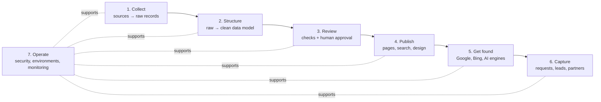

# Clerikaa: Product and Engineering Plan

> **Living document.** Last updated: **2026-10-31**. Owner: rajjys.
> This file is the single source of truth for where the project is going, what is done, and what comes next.
> Anyone joining the project should be able to read it top to bottom and know what to work on.

---

## How to use this plan

**Status legend:** ✅ done · 🟡 in progress · ⬜ not started · ⏸ on hold · ❓ needs a decision

**Rules**
1. Every work item has an ID (e.g. `C-2`). Reference it in PR titles and commit messages so progress is traceable.
2. A PR that finishes an item updates its status here in the same PR.
3. Every product or technical decision goes in the [Decision log](#8-decision-log) with its date and reason. Decisions are not re-opened without new facts.
4. Facts in this plan are verified against a source. When something is an assumption, it says so.

**Detailed documents** (index: [docs/README.md](README.md))
- [ROUTE-MODEL.md](ROUTE-MODEL.md): route-centric data model, back office and build phases RW-1 → RW-7
- [DESIGN-SYSTEM.md](DESIGN-SYSTEM.md): brand, tokens, components, data display rules
- [SEO-AEO-GEO.md](SEO-AEO-GEO.md): binding rules for public pages, search engines and AI engines
- [DATA-SOURCES.md](DATA-SOURCES.md): sources, OAG/Cirium, airline systems and the partnership plan
- [ANALYTICS.md](ANALYTICS.md): visit statistics, sources and request attribution, the dashboard, limits and how to check them

**Contents**
1. [The problem](#1-the-problem)
2. [The product](#2-the-product)
3. [Business path](#3-business-path)
4. [Principles](#4-principles)
5. [Where we are today](#5-where-we-are-today)
6. [The pipeline: seven stages](#6-the-pipeline-seven-stages)
7. [Milestones](#7-milestones)
8. [Decision log](#8-decision-log)
9. [Waiting on](#9-waiting-on)
10. [Risks](#10-risks)
11. [Glossary](#11-glossary)

---

## 1. The problem

In the DRC, finding out **which airline flies a domestic route, on which days, at what time and for roughly what price** is hard:

- Airline websites are difficult to use, and some booking engines only show results after a full search.
- Travellers call the airline or a travel agency. Some agents hide flights from airlines that don't pay them a commission ("there is no flight today").
- Global travel sites (eDreams, Kayak, Jetcost, rome2rio…) rank on Google for these searches, but give template pages:
  - prices in EUR, or monthly averages
  - airlines that are grounded (Congo Airways has not flown since April 2025)
  - airports that are closed (Goma has been closed since January 2025)
- Nobody publishes **dated, sourced, route-by-route** information for DRC domestic flights.

## 2. The product

**What it is:** an informational website for DRC domestic flights. For each route it shows:
- the airlines operating it and the days they fly
- departure and arrival times (local)
- an **indicative price** with the date it was observed and its source
- the current status of airports and airlines (closed, suspended, operating)

**What it is not (for now):** an airline, a ticket seller, or a booking engine. Prices are indicative; the airline or an agency confirms the final fare.

**Who it serves**
1. **Travellers** who want to compare before calling anyone.
2. **Travel agencies** later: as a lead source first, then as a product they license for their own website.
3. **Search engines and AI assistants**, which need a reliable, citable source for DRC flight questions.

**Scope today:** domestic DRC routes · prices in USD · French first, English second.

## 3. Business path

Each step only starts when the previous one shows value.

| Step | What we do | What it proves | Status |
|---|---|---|---|
| 1. Intent capture | Rank on Google for searches like "prix kinshasa kalemie caa". Answer them with accurate data. | People want this and find us. | 🟡 building |
| 2. Leads | Travellers send flight requests. We pass them to partner agencies and earn a commission. | The traffic has commercial value. | ⬜ |
| 3. Licensing | An agency uses the platform to power its own website (white-label). | The software itself has value. | ⬜ |
| 4. Official data | With an agency partner (and its licences), request direct data feeds or APIs from airlines. | Data quality at scale. | ⬜ |

## 4. Principles

These rules decide every trade-off. If a task breaks one of them, the task changes.

1. **Accuracy over coverage.** Every price and schedule shows *when* it was checked and *where* it came from. Unverified data is not published.
2. **Only publish pages that have real data.** No auto-generated pages for routes nobody flies (see [Risks](#10-risks), Google spam policies).
3. **Automate collection, a human approves publication.** One person runs this project, so machines do the repetitive work. Nothing reaches the public site without passing the review step.
4. **Collect data legally and politely.** Respect robots.txt and terms of use. Never bypass bot protection. When a source says no, we ask for permission instead.
5. **Zero budget until there is revenue.** Free tiers only. Any paid service needs a decision in the log.
6. **Mobile-first, low-bandwidth.** Most users are on Android phones with slow or expensive data.
7. **No personal data leaks.** Admin areas stay behind login; customer data is never exposed by the public API.

## 5. Where we are today

Snapshot on **2026-10-31**:

| Area | State |
|---|---|
| Security | ✅ Admin login, all write APIs protected, Next.js upgraded (4 critical vulnerabilities fixed), customer data no longer public. Deployed and verified in production (PR #1). |
| Data model | ✅ Schema v3, route-centric, in production (**RW-1**, PR #8, 2026-10-31): routes with status and priority, airlines on routes, flights on dates, change history ([ROUTE-MODEL.md](ROUTE-MODEL.md)). |
| Data | 🟡 **Production:** reference data loaded (2026-10-31); old data deleted with a backup (2026-10-31). On 2026-11-01, at the owner's request, the local preview data was copied in for the team to review: 586 upcoming flights on 44 airline-on-route records and 4 new routes (`scripts/push-preview-to-production.ts`). **CAA is published** (official timetable of 20 Oct, times confirmed by Skyscanner and FlightStats). **Air Congo is published too** (owner, 2026-11-01: "the ones from the schedule, ignore Skyscanner for now"): its 20 airline-on-route records from the schedule PDF, by `scripts/publish-route-airlines.ts`, each logged in the route's history. **All 38 production routes were set to *Publiée* on 2026-11-02** at the owner's request, by `scripts/publish-routes.ts` (each logged in the route's history): 34 are indexable; the 4 Kalemie and Muanda routes stay `noindex` until an airline is published on them. Each import is one action per route, so "Défaire" removes it. **Local:** the same preview data; the 5 Air Congo prices are pending, as in production. |
| Brand and design | ✅ **Clerikaa** in code (still served from `lebourgeois.cd`). Design system v1 merged (PR #5): tokens, font, logo, components, `/dashboard/design`. |
| Public site | 🟡 Home rebuilt and rendered on the server (P-9, PR #6). Navbar search button, contact page and form fixes live (P-12, PR #7). Search results redesigned and read from dated flights, with a server-rendered flight page (P-13, PR #11). **RW-5 (PR #15, merged):** search and route pages are one structure under `/vols`, rendered on the server; `/explore` redirects there. **P-15 (PR #16, merged):** booking card and calendar redesigned, airlines before departures, dates at the bottom, `/about` and footer rewritten. **P-16 (PR #17, merged):** route page order search → airlines → departures, a one-line search on phones, "report a mistake" starts the message, phone navbar and menu redesigned. **P-17 (PR #18, merged):** phone polish: a smaller type step for headings on phones, tighter spacing, the search as one compact card, and choosing the departure opens the arrival list. **P-18 (in review):** a route page with a date shows the departures only. The request page is still rendered in the browser. |
| Search and sharing | 🟡 **F-2, F-3, F-4 (in review):** every public page has its own title, description, canonical address **and link preview** (title, description, address and image of the page itself; until now WhatsApp showed the home's for every page). Route and airline pages get a share image drawn from their data in the brand font. Route and airline titles drop " | Clerikaa" so the route words fit before Google cuts them. `Organization` on the home; sitemap without `priority`/`changefreq`, dated by data changes, with `/contact`. AI crawlers allowed by name, training ones included (F-6, owner). Still to do: Search Console and Bing (F-5), English URLs (F-1). |
| Leads | 🟡 Request form and contact form save to the database; both are visible in the back office (Demandes, Messages). Email alerts are built but on hold. **AN-1 to AN-3 (in review, 2026-11-10):** our own visit statistics, each request credited to where its traveller came from, a *Statistiques* page, and request outcomes (*Réservée* / *Sans suite*). Until then: 6 requests in production (4–10 Nov), all still "Nouvelle", 4 of them for Air Congo flights. |
| Environments | ✅ Separate local dev database. Production migrations run automatically on deploy. |

---

## 6. The pipeline: seven stages

The product is a pipeline. Data enters at stage 1 and reaches people at stages 4–6. Each stage has:
- an **input** and an **output**
- **quality metrics**
- **improvement levers**

As long as a stage keeps producing the output the next stage expects, it can be improved on its own without touching the others.

### Stage 1: Collect

**Purpose:** get schedules, prices and statuses from the outside world into our system.
**Input:** external sources. **Output:** raw records with source URL and date, waiting for review.

#### The three collection levels
These are the original three approaches. They **run side by side**; a higher level does not replace a lower one.

| Level | How | Strength | Weakness | Status |
|---|---|---|---|---|
| **L1: Manual** | The operator manages each route in the back office (from airline sites, timetables, phone calls, agencies). | Works for any airline, any route. Most trustworthy today. | Depends on one person; needs good tools. | 🟡 **priority**: the route workspace (RW-1 → RW-4) makes it fast |
| **L2: Automated collection** | Daily jobs read **public, allowed** sources (timetable PDFs, airline homepages) and propose records for review. | Fresh and cheap. | Breaks when a website changes; legal grey zone. | ⏸ **paused**: owner decision, manual first (C-2, C-3) |
| **L3: Official feeds** | Airline data feeds or APIs under an agreement. | Most accurate; includes live fares. | Needs permission, usually an agency/IATA partner. | ⬜ **next after the first live routes**: partnerships (C-7), see [DATA-SOURCES.md](DATA-SOURCES.md#5-partnership-plan) |

**Trust order when sources disagree:** L3 official feed > airline timetable > airline website > manual entry > traveller report.

#### Source register
Verified on 2026-10-30.

| Source | Gives | Allowed? | Freshness | Use |
|---|---|---|---|---|
| CAA weekly timetable PDF (`caacongo.com/horaires.html` → PDF) | Flight numbers, days, local times, block times, aircraft | ✅ robots.txt allows (10 s crawl delay) | Weekly; file valid from 20/10/2026, updated 26/10/2026 | **L2 importer (C-2)** |
| Air Congo homepage "From USD" fares | Lowest advertised fare per destination | ✅ no robots.txt, no terms found | Read 30/10/2026; origin not stated (Kinshasa assumed, needs review) | L2 reader (C-3); 5 fares already recorded as pending |
| Air Congo schedule PDF | Routes, days, times (no flight numbers) | ✅ | Stale (created 22/04/2025) | Reference only |
| CAA booking engine (Videcom) | Live fares and seats | ❌ robots.txt `Disallow: /` | n/a | **Do not use** without written permission |
| Air Congo booking (Ethiopian Sabre DX) | Live fares | ❌ behind Akamai + Imperva bot protection | n/a | **Do not use** |
| Amadeus Self-Service API | n/a | ❌ shut down July 2026 | n/a | Rejected |
| Duffel API | n/a | ❌ contract §2.5(d) bans metasearch; carries no DRC domestic airline | n/a | Rejected |
| OAG / Cirium | Schedules (Cirium carries both CAA and Air Congo; OAG unverified) | ❌ no free licence allows publishing; both forbid resale | n/a | **Not now** ([DATA-SOURCES.md §2](DATA-SOURCES.md#2-oag-and-cirium-can-they-help)) |
| AeroDataBox | Schedules, 68% coverage for Kinshasa | ✅ on paid plans (about $7.50/month) | n/a | Optional cross-check after first revenue (O-9) |
| News and official notices (RVA, ACP, actualite.cd) | Airport and airline status | ✅ | As published | Manual status updates |

#### Work items
- ✅ **C-1:** Fast fare entry, in the route workspace (**RW-4**, PR #12): amount, fare name and source in one row, Enter saves, observed today by default.
- ⏸ **C-2:** CAA timetable importer (paused: manual first). If resumed, it proposes flights into the route workspace (ROUTE-MODEL §6.3). Steps:
  - a daily job fetches `horaires.html` and follows it to the current PDF
  - it skips the file if unchanged (hash check)
  - it parses rows by position, reading the column order from each page's header (some pages swap DEPARTURE/ARRIVAL)
  - it creates schedule proposals marked *pending*
- ⏸ **C-3:** Air Congo fare reader (paused: manual first).
- Local preview data (2026-10-31, not an importer): `scripts/load-dev-timetables.ts` holds CAA's 20 Oct timetable and Air Congo's schedule PDF, typed in by hand. Local databases only; the PDFs give no end date, so the script assumes one. Air Congo publishes no flight numbers, and two of its rows have impossible times (left out).
- ⬜ **C-4:** Source snapshots: store every fetched file (URL, date, hash) so each record traces back to the exact document it came from.
- ⬜ **C-5:** Status watch: airport and airline statuses are updated by hand from news for now; consider keyword alerts later.
- ✅ **C-6:** Schedule APIs evaluated (2026-10-30): OAG and Cirium not now; AeroDataBox is the only affordable cross-check. See [DATA-SOURCES.md](DATA-SOURCES.md).
- ⬜ **C-7:** Airline partnerships (CAA, Air Congo). Asks, offer and contacts are in [DATA-SOURCES.md §5](DATA-SOURCES.md#5-partnership-plan). Starts once the first routes are live (M5).
- ⬜ **C-8:** Level 3 feeds through an agency partner.
- ⬜ **C-9:** Traveller reports ("I flew this, I paid X"), moderated.
- 🟡 **C-10:** Timetable update script, `scripts/update-timetable.ts` (2026-11-10). A newer timetable is typed in by hand under `data/timetables/` (not an importer: C-2 stays paused) and the script brings the stored flights in line over a window: adds, retimes, confirms, and removes the scheduled flights the newer document no longer lists. Cancelled flights are left alone. Preview by default; `--apply` writes one "Appliquer un horaire" batch per airline-on-route, so "Défaire" in the route workspace reverses it (checked locally on Kinshasa → Kananga). First use: CAA's timetable of 11 Nov 2026 over 11 → 29 Nov (the last date already stored): **+101 flights, 159 retimed, 65 removed, 50 confirmed** on 26 city pairs, the same plan locally and in production (both still held the 20 Oct timetable). Applied locally; **production waits for the owner** (the assistant cannot write there).

**Quality metrics**
- % of published routes whose schedule was verified in the last 7 days
- % with a fare observed in the last 14 days
- importer success rate
- delay between a source changing and a proposal appearing

**Improvement levers:** more independent sources per route, more frequent checks, better parsing, permission for richer sources.

**Risks:**
- Timetable layouts change. Mitigation: hash checks, parse sanity checks, and an alert on failure.
- Legal exposure. Mitigation: register above; only allowed sources.

### Stage 2: Structure

**Purpose:** turn raw records into clean, consistent data with rules the database enforces.
**Input:** raw records. **Output:** airports, airlines, routes, schedules and fare observations, each with source and status.

**Data model:** schema v2 is in production. **Schema v3 (proposed)** makes the route the centre: route → airline-on-route → flights on dates + price observations. See [ROUTE-MODEL.md](ROUTE-MODEL.md). Schema v2:
- **Airport:** IATA code, slug, city, province, **IANA timezone** (validated), status (open / restricted / closed) with note, date and source URL.
- **Airline:** IATA code (CAA = `BU`, Air Congo = `4H`, Congo Airways = `8Z`), slug, status (operating / suspended / ceased) with source, published flag.
- **Route:** a directional city pair (e.g. `kinshasa-lubumbashi`) with a published flag. Only published routes get a page.
- **Flight schedule:** flight number, days, local times, validity dates, aircraft, plus source, verification date and review status.
- **Fare observation:** one price seen at one moment. Fields:
  - amount and currency
  - kind: an advertised "from" price, or a quote for a specific date
  - one-way or round-trip
  - date observed
  - source
  - note
  - review status

  **Prices are history, not a property of a schedule.**

**Work items**
- ✅ **S-1:** Schema v2 in production (PR #3). Reference data loaded by the owner on 2026-10-31.
- ✅ **S-9:** Schema v3, route-centric (= **RW-1**, PR #8, merged 2026-10-31).
- ⬜ **S-2:** Source snapshot table (with C-4).
- ⬜ **S-3:** Remove the old `FlightPattern.price` column (part of **RW-7**).
- 🟡 **S-4:** Flight numbers stored as written (`BU1611`, `ET60`; Air Congo sells under ET numbers), shown `BU 1611`. Storage rules and database checks done in **RW-1**: one departure per route-airline, date and number, and per date and time (Air Congo's timetable has no numbers, so the number can be empty). Typed and shown in the back office since RW-3; shown publicly on the airline pages since RW-5.
- 🟡 **S-5:** Change history (`ChangeLog`, **RW-1**): every back-office write to airports, airlines and schedules is recorded with who, when and the before/after values, in the same transaction. Since RW-4 (PR #12), each route page has a history panel: every workspace action with its detail, undone ones marked, plus single edits. The back-office-wide log is B-5.
- ⬜ **S-6:** Airport coordinates → distances and flight durations.
- ⬜ **S-7:** Baggage allowance and fare rules per airline.
- ⬜ **S-8:** Data scoping per agency (needed for licensing, Business step 3).

**Quality metrics:** zero invalid records (enforced by constraints and validation); 100% of public records have a source and a verification date.

**Improvement levers:** stricter constraints, normalisation, history tables.

### Stage 3: Review

**Purpose:** the quality gate. Automatic checks catch obvious errors; the operator approves what goes public.
**Input:** pending records. **Output:** approved or rejected records.

**Today:**
- Every schedule and fare has a review status, and the public API only returns approved data.
- **There is no review screen yet.** 35 fares are waiting: 30 old prices plus 5 Air Congo fares.

**Work items**
- 🟡 **R-1:** Review queue, inside the route workspace. Pending fares: **RW-4** (PR #12), per airline, validate or reject one, a selection or all; the routes board counts them and filters "Prix à valider". Imported flights as "ghost" proposals come with the importers (ROUTE-MODEL §6.3).
- ⬜ **R-2:** Automatic checks before review:
  - departure + block time + timezone difference must equal arrival (tested on CAA's timetable: 79 of 82 rows reconcile)
  - duplicates
  - price outliers against history
  - flights to closed airports
- ⬜ **R-3:** Staleness rules. A schedule not re-verified in *N* days is shown as "à vérifier" or hidden. A fare older than *N* days drops out of "à partir de". *N* to be set once the importer runs.
- ⬜ **R-4:** Daily digest email: what changed, what waits for review. Needs email (L-4).

**Quality metrics:** queue size, median time a record stays pending, % passing automatic checks, error reports from users.

**Improvement levers:** better automatic checks mean less manual work. Batch approval when importer confidence is high.

### Stage 4: Publish

**Purpose:** the public product: what travellers see and use.
**Input:** approved data. **Output:** fast, clear, trustworthy pages on phones.

**Today:**
- The home page is rendered on the server (P-9). Search (`/explore`), flight detail, request form, contact and about are rendered in the browser (contact has its metadata on the server).
- The FR/EN switch happens in the browser only.
- Design system v1 is applied through tokens. Search and the flight page were replaced by the `/vols` pages in RW-5; the request page keeps its old layout until L-9.

**Work items**
- 🟡 **P-1:** Design research. Principles and references are in [DESIGN-SYSTEM.md](DESIGN-SYSTEM.md#2-principles); a fuller competitor study is still to do. Study:
  - Google Flights, Skyscanner, Kayak, Wego, Travelstart
  - airline sites (Ethiopian, Kenya Airways, RwandAir)
  - local habits: WhatsApp sharing, Android, slow networks

  Output: research notes and design principles.
- ✅ **P-2:** Design system v1 (PR #5, merged 2026-10-30): tokens in a format a future mobile app can reuse (DTCG JSON), contrast checked in the build, Plus Jakarta Sans, Clerikaa logo, restyled primitives, product components (price, freshness, route title, airline mark, day strip), live reference at `/dashboard/design`. See [DESIGN-SYSTEM.md](DESIGN-SYSTEM.md). Remaining components (search box, route card, schedule table…) come with RW-3 and RW-5.
- ⬜ **P-3:** Server-rendered pages built from real data:
  - home (✅ done in P-9)
  - route and route + airline pages (= **RW-5**, ✅ PR #15)
  - airline, airport and network status pages (= **E-1 → E-3**)

  URL plan in [SEO-AEO-GEO.md](SEO-AEO-GEO.md#3-urls-and-site-structure).
- ⬜ **P-4:** Trust details everywhere:
  - every price shows "relevé le JJ/MM/AAAA" and its source
  - banners for closed or suspended airports and airlines
  - a clear disclaimer: "indicative prices, we are not an airline"
- ⬜ **P-5:** Performance budget for DRC networks: little JavaScript, HTML from the server, light images. Target: good Core Web Vitals on mobile (measured with Lighthouse mobile).
- ⬜ **P-6:** Installable web app (PWA) that keeps recently viewed routes offline.
- ⬜ **P-7:** Price history chart per route.
- ⬜ **P-8:** Native mobile app, only if usage justifies it. It would reuse the design tokens.
- ✅ **P-9:** Navigation and home v2 (owner feedback, 2026-10-31; PR #6, merged):
  - navbar lists sections (the search button came back in P-12); mobile menu opens from the right
  - home hero: "Horaires et prix indicatifs des vols en RDC" with the search form (origin, swap, destination; no date, one way)
  - home sections rendered on the server: next departures (dated, nothing auto-moves), tracked routes, airport statuses, how we work
  - search reads `?from=&to=`; closed or restricted airports warn on selection and when nothing is found; "ask for help" appears after a failed search
  - request form moved to the footer and to failed searches; `/explore/[id]` set to `noindex` until RW-5
  - back-office sidebar grouped (Données de vol, Clients, Administration), new icons, docks to an icon rail (Ctrl+B)
- ⬜ **P-10:** Trust pages, server-rendered (M4): `/a-propos`, `/methodologie` (how we collect, date and verify). `/contact` moved to P-12 and moves to its French URL with the rest.
- ✅ **P-12:** Owner feedback round 2 (2026-10-31; PR #7, merged):
  - navbar: logo left, sections centred (À propos, Contact), **"Rechercher un vol" button** and language on the right. On a page with a search form the button scrolls back to it and focuses "Départ"; elsewhere it opens `/explore`. The "Vols" link left, since it led to the same page; it returns as the route index with RW-5.
  - `/contact` with its own form: question, error report, airline, other; answer by email or WhatsApp; honeypot against bots. `?sujet=erreur&page=…` lets any page link to "report a mistake here". Messages land in the back office (Clients → Messages: to do, answered, archived).
  - back office: airport and airline forms rebuilt with **status, since-date, public note and source** (Goma and Bunia were set by the seed but could not be edited), province, coordinates, links, visibility; live preview of the public airport warning; deletes refused with a clear message while flights or fares use the record. Saving refreshes the cached home page.
  - search fields keep their width with long airport names (hero and `/explore`); the `/explore` date field lines up with "De" and takes the full width on phones
  - fixes: crash on an unknown `/explore/<id>`, stray "0" for direct flights, airline logos replaced by the airline mark (no logos without permission), dialog accessibility warning
  - local preview data from the CAA and Air Congo PDFs (see Stage 1)
  - follow-up (RW-1 pull request): the owner's WhatsApp number on `/contact`, next to the email, and in the message shown when sending fails
  - follow-up (RW-2 pull request): "Accueil" in the navbar, before À propos and Contact (owner)
  - follow-up (RW-3 pull request): creating a route that already exists now says so as soon as both airports are picked, with an "Ouvrir" link to each existing direction (owner)
- ✅ **P-13:** Search results v2 (owner, 2026-10-31, after comparing with Skyscanner; PR #11, merged 2026-11-01):
  - results come from dated flights (schema v3), grouped as **services**: one airline's flight with the same number, times and stops. One card per service, not per date.
  - card: airline name on top, its logo on the left (its code when we have no logo), departure and arrival times with airport codes, duration, direct or stops in the middle, price and "Voir le vol" on the right; price and button at the bottom on phones. Flight number and aircraft move to the flight page.
  - the week view is redesigned (flying days tinted, the searched day or next departure solid) and stays on every card; "Prochain vol : …" shows only when no date was chosen.
  - tabs **Recommandé · Moins cher · Plus rapide · Plus proche**, each showing its first result's value. Recommandé = direct flights first, then the best balance of departure, price and duration.
  - `/explore/[id]` is now one departure (server-rendered): times and airports, duration, stops, number, aircraft, flying days, other departures, price with its date and source, and **"Réserver ce vol"**: the booking request to Clerikaa as before (travellers, class, name, phone with WhatsApp or email; a fixed bar and a dialog on phones). Requests carry the flight's date, its number (or airline and time when it has none) and the route. Still `noindex` until RW-5.
  - logos (owner, 2026-10-31): CAA's from the file the owner supplied, Air Congo's from the image already linked in the database, both served by the site from `public/logos/airlines/` and set by a data migration. Air Congo is shown as Air Congo, never as Ethiopian.
  - the home sections (next departures, tracked routes) read dated flights too.
  - public rule: a flight shows once it is validated and scheduled, its airline is published, and the airline is published on that route.
  - "Programmes de vol" retired from the back office (screens, API and helpers removed); the `FlightPattern` table is dropped in RW-7.
- ✅ **P-14:** Home tweaks (owner, 2026-11-01; PR #14): next departures go 2 → 3 → 4 columns (6 cards below 4 columns, so no half-empty row; airline name on one line); the phone carousel keeps its margin when a card snaps; "Trajets suivis" shows P1 routes only, at most nine (the rest goes to `/vols` in RW-5).
- ✅ **P-15:** Owner round 3 (2026-11-02; PR #16):
  - **"Réserver ce vol"** redesigned: a header with the departure (airline, date, times, number), the price only when one was seen, travellers with − and +, class, name and **phone only** (no email, no "WhatsApp" box: the team calls or writes on WhatsApp), errors under each field, and "Aucun paiement maintenant" under the button. On phones the bar's button is centred, and the form opens as a **sheet from the bottom with the button on the bottom edge** (it was a centred dialog with empty space below). The help request form (`/request`) asks for a phone only too, with the same − and +.
  - **Calendar:** the search box's date opens our own calendar (weeks from Monday, past days off, today outlined); on a route page, days with a known flight carry a dot. Phones get it as a sheet from the bottom, wider screens as a popover. Replaces the browser's date input.
  - **Route page order:** "Par compagnie" first (each airline row is one link), then the search box and the departures.
  - **Dates and sources at the bottom** of route and airline pages ("Mis à jour le · Horaires vérifiés le · Sources"), with "Signaler une erreur" for that page and the disclaimer.
  - **`/about` rewritten** (server-rendered, with metadata): the problem, what the site offers, the method, the limits, our intention, and how to take part (report a mistake, share information, airlines and agencies, help the project); live figures from the `/vols` data. **Footer** follows the same structure (Explorer · Clerikaa · Participer, WhatsApp).
  - Return-trip link: shown only when the return page is worth a visit (departures, or indexable), never on a `noindex` page.
- ✅ **P-16:** Owner round 4 (2026-11-02; PR #17, merged):
  - **Route page order:** header and alerts, **search box**, "Par compagnie", "Départs", then the rest (owner: the search box was lost between the two).
  - **Search on phones:** on a route page the search already made shows as one line ("Kinshasa → Lubumbashi · Toutes les dates · Modifier") that opens the full form; the navbar's search button opens it too. Measured at 390 × 844: the full form is about 430px tall and pushed "Par compagnie" to 799px; with the line, the first airline card ends at 694px. Wider screens keep the form on one row.
  - **"Par compagnie" on phones:** the count of flights this week only, no departure times, so an airline with many times does not make its card taller (times stay on wider screens and on the airline page).
  - **"Signaler une erreur"** (bottom of route and airline pages): the contact form opens on that topic with the message started, "Page : Kinshasa – Lubumbashi · CAA, mardi 10 novembre 2026, 08:00 / Ce qui est faux : ", and the cursor after it; sending the started text alone is refused. The page's path (with the day) still goes with the message to the back office (Messages shows "Page : …"). The phone menu has the same link.
  - **Navbar on phones:** a round, light pink search icon instead of the full button (the full button from 640px), a borderless menu icon, and a menu with the logo and a close button, large links with icons and the current page marked, one "Rechercher un vol" button, a Français | English switch, WhatsApp and "Signaler une erreur". Opening the menu no longer puts a focus ring on its first control.
  - **Copy:** bookings are forwarded to partner travel agencies, which issue the ticket (contact, `/about`, home, booking card, page disclaimer); every report is read by a person and fixed as soon as we have the update; "Aider le projet" is about content (schedules, prices), not the site.
- ✅ **P-17:** Phone polish for V1 (owner, 2026-11-02; PR #18, merged). Owner: text larger than needed on phones, too much white space, a search form that "reflects the time when we couldn't design beautifully" next to Skyscanner's compact one; "a final V1 premium polish, not a total overhaul". Measured at 390 × 844 before and after:
  - **Type scale for phones** (`TYPE` in `components/ds/typography.ts`, [DESIGN-SYSTEM.md §5](DESIGN-SYSTEM.md#5-typography)): home title 36 → 30 px (three lines → two), page titles 30 → 24 px, data-page sections 20 → 18 px, lead lines 18 → 16 px; desktop sizes unchanged from 1024 px. Body text stays 16 px. Every public heading now takes its size from `TYPE` (home, `/vols`, route, airline, contact, request, `/about`), so sizes no longer drift between pages.
  - **Search card** (`components/search/SearchForm.tsx`, shared by the home, `/vols` and route pages): one card of 56 px rows, icon and label inside each row, the swap button on the line between departure and arrival, the button closing the card; one row from 1024 px (tablets keep the stacked card, as the cities were cut short beside the date at 768 px). Home: 314 → 178 px tall. With the date (`/vols`, route pages): 426 → 237 px.
  - **Departure → arrival:** choosing the departure opens the arrival list, on the arrival already chosen if any; the departure is left out of the arrival list; choosing the current arrival as departure clears it. On touch screens the lists open without the keyboard, so it does not cover them.
  - **White space on phones:** navbar 64 → 56 px; 24 px between blocks of a page (32 from 640 px); home sections 40 px apart; airline cards on the route page put the flights this week, the price and a chevron on one line (187 → 135 px without a price); smaller times and tighter facts in the departure block; result cards and sort tabs slightly tighter; the hero's tracked routes on one swipeable row instead of one per line.
  - Result: "Prochains départs" starts at 629 px instead of 1027 (home); the first route group of `/vols` at 536 instead of 787.
  - **Round 2 (owner, same day):** route pages show the **same search card as the home** (with the date) on phones too, replacing P-16's one-line summary; the first airline card still ends on the first screen (663 px). **Airline page on phones:** the departure block keeps one large figure (the times) and drops the capitals in its labels; stop names wrap in a narrow column without splitting "Mbuji-Mayi"; time and date chips sit on one swipeable line (the 14 dates took five lines); every "Vols et horaires" row has the same shape; "Aller simple" is capitalised; "Comparer les compagnies sur ce trajet" fits one line. The CAA page on Kinshasa → Lubumbashi went from 3577 to 2789 px. **Everywhere:** breadcrumbs on one line; French non-breaking spaces before `: ; ! ?` (a footer link ended on a lone "?"); dates and web addresses never split across lines at the bottom of pages; `/vols` lists each city's routes as one list on phones; footer spacing tightened; the 404 page is in French with the navbar, footer and two ways forward. Result cards are left as they are (owner).
- 🟡 **P-18:** Route page with a date (owner, 2026-11-02; in review). "Par compagnie" shows each airline's week on the route; once a date is chosen it said nothing about that day, so a dated route page (`?date=`) shows the departures only. A **"Toutes les dates"** link beside the date brings the full page back (the breadcrumb's last item is not a link). The address without a date keeps the airline list, and it is the canonical one, so search engines still see it.
- ⬜ **P-11:** "Ma ville": a visitor picks their city and the home and hub lists show its routes first (owner idea: someone in Kolwezi cares about Kolwezi first). After M4; airport pages (E-1) already serve this for search engines.

**Airports and airlines as pages** (owner, 2026-10-31). They are hubs for internal links and answer their own searches ("aéroport de Goma", "Air Congo").
- ⬜ **E-1:** Airport pages `/aeroports/[slug]` (M4):
  - status, the date since when and the source, at the top (this is where Goma's and Bunia's closures live)
  - routes from and to the airport, airlines serving it, next departures
  - facts: codes, city, province, map, time zone
  - a short note written by us (distance to town, practical tips)
  - back office: status, facts and position are editable since P-12; the full airport manager is **B-2**
- ⬜ **E-2:** Airline pages `/compagnies/[slug]` (M4): status, routes, booking channels, facts, our notes. The airline status is stored and editable (P-12) but not shown publicly until this page and RW-5. Back office: **B-3**.
- ⬜ **E-3:** Network status page `/etat-du-reseau` (M4), built from airport and airline statuses.
- ~~**E-4:** Facts from Wikidata.~~ Dropped (owner, 2026-10-31): airport and airline pages use **our own structure, filled in and customised in the back office** (B-2, B-3). No import from Wikipedia or Wikidata: duplicated content adds nothing. See [SEO-AEO-GEO.md §9](SEO-AEO-GEO.md#9-content-rules-and-spam-policies).
- ⬜ **E-5:** Editorial content once there is traffic (M6): guides, photos (own or licensed and credited), real moderated testimonials.

**Back office v2** (owner, 2026-10-31: "how it looks, what it says and what it does"). Today's screens are basic forms over the database. The route workspace (RW-1 → RW-4) covers schedules and prices; these items cover the rest.
- 🟡 **B-1:** Tableau de bord rebuilt around the operator's day (M3; in review):
  - four figures: **P1 routes up to date** out of 18 with a meter and the milestone target (10), flights in the next 7 days, requests to handle (and contact messages), prices to validate
  - to do, most important first: P1 routes with no airline yet ("à mettre en place"), routes to re-check (never checked or past 7 days), schedules to extend (flights known for less than two weeks), prices to validate
  - beside it: new requests, new messages, public statuses (closed airports, suspended airlines) with links to edit them
  - recent activity across routes, undone actions marked
  - every list links to the route or to the routes board already filtered (`/dashboard/routes?a=todo|empty|prices&p=1`)
  - "à jour" = an active airline published on the route, every active airline checked within 7 days, flights known for the coming week. The same rule will measure the M3 exit test.
- ⬜ **B-2:** Airport manager (M4, with E-1): list with search and filters; one screen per airport with its status and status history, routes and airlines serving it, next departures, and **editable content in our own structure**: our note, practical information (distance to town, transport, tips), photos with credit, links. Preview of the public page.
- ⬜ **B-3:** Airline manager (M4, with E-2): same pattern, plus booking channels, baggage and fare names, private contacts, the routes it serves and its change log.
- ⬜ **B-4:** Requests and messages inbox (M5, replaces L-1): one inbox for requests and contact messages; statuses (new, in progress, answered, closed), internal notes, assignment once there are several users (O-7), reply shortcuts (email, WhatsApp), search and filters, time to first answer.
- ⬜ **B-5:** Change log (M6): who changed what and when on airports, airlines and routes. Feeds the "dernière mise à jour" lines and the public change history.

**Quality metrics:** Core Web Vitals (mobile), searches per visit, share of visits that reach a route page.

**Improvement levers:** design iterations, performance, content clarity.

### Stage 5: Get found

**Purpose:** appear in Google, Bing and AI assistants when people ask about DRC flights.
**Input:** published pages. **Output:** visits from search and citations by AI engines.

**Today** (review of 2026-11-02, on production `lebourgeois.cd`):
- Route, airline, hub, home and `/about` pages are rendered on the server: the facts are in the HTML (RW-5).
- Each page has its own title, description and canonical address. Until F-2 (2026-11-02) the **link previews** were the home's on every page: `og:title`, `og:description`, `og:url` and the X tags came from the root layout, so a route shared on WhatsApp showed the home.
- French and English share one URL, so only French can be indexed.
- A bug that told Google every page was a copy of the homepage has been removed.

**URL structure: decided 2026-10-30.** All public URLs in French at the root (`/vols/kinshasa-lubumbashi`, `/vols/kinshasa-lubumbashi/caa`, `/compagnies/caa`, `/aeroports/kinshasa`, `/etat-du-reseau`); English later under `/en/` with English slugs. Full table, rules and the binding page checklist: [SEO-AEO-GEO.md](SEO-AEO-GEO.md).

**Work items**
- ⬜ **F-1:** URL structure and server-side language routing.
- 🟡 **F-2:** Per-page title, description, canonical URL and share image, generated from data (e.g. "Vols Kinshasa → Kalemie : compagnies, horaires et prix"). In review (2026-11-02, after the owner's review of `/`, `/vols`, route, airline and `/about` pages):
  - **Link previews are the page's own** (`pageMetadata` in `lib/seo.ts`, used by every public page): `og:title`, `og:description`, `og:url` and the X card follow the page. Before, the root layout's values were inherited everywhere.
  - **Share images:** route pages and airline pages draw theirs from the data (route, who flies, flights this week, lowest price with its date, the airline's logo), 1200 × 630, about 60–75 KB; the site's image for the rest. All in Plus Jakarta Sans (`assets/fonts`, OFL): the image generator's default font has no bold, so the old image lost the wordmark's weight.
  - **Descriptions:** prices carry the year ("observé le 30 octobre 2026"), as search results and previews are kept for months; airline pages give a range when there are more than three departure times (CAA Kinshasa – Lubumbashi listed ten, 205 characters); the site description says "prix observés", not "tarifs vérifiés" (we date prices, we don't verify fares).
  - **Titles:** route and airline pages drop " | Clerikaa" (owner, 2026-11-02). With it they ran 69 to 75 characters and Google cuts around 60, so the suffix, then the airlines, were what disappeared; Google shows the site name above the result anyway. The home, `/vols`, `/about` and the forms keep it.
  - **`/request`** has its own title and description (it showed the home's) and its heading is "Demander de l'aide pour un vol" instead of "Demander un Devis Personnalisé… les meilleures options de vol".
- 🟡 **F-3:** Sitemap generated from the database: only published pages; `lastmod` = when the route's data last changed (route or its flights). In review: `priority` and `changefreq` removed (Google ignores them); the home, `/vols` and `/about` take the latest data change; `/contact` added.
- 🟡 **F-4:** Structured data that Google still uses: BreadcrumbList (desktop only since Jan 2025), Organization. BreadcrumbList is on `/vols`, route and airline pages (RW-5); **`Organization`** (name, logo, description, WhatsApp contact) on the home is in review. No address: the site publishes none. `/about` and `/contact` show no breadcrumbs, so they carry none (structured data must describe what is visible).
  - Google has no rich result for flights or routes.
  - FAQ rich results were removed from Google Search on 7 May 2026 (verified). An on-page FAQ is still fine.
- ⬜ **F-5:** Google Search Console + Bing Webmaster Tools; IndexNow, so Bing and Copilot pick up changes quickly.
- 🟡 **F-6:** robots.txt generated from code (`app/robots.ts`, domain-independent). In review: the AI crawlers of [SEO-AEO-GEO.md §8](SEO-AEO-GEO.md#8-ai-engines-specifically) are **allowed by name**, search, user-requested and **training** ones (GPTBot, ClaudeBot, Google-Extended, Applebot-Extended; owner, 2026-11-02). Their group repeats the private paths (`/dashboard`, `/api/`, `/login`), because a crawler that finds its own name skips the `*` rules.
- ⬜ **F-7:** First content batch. Each page is built only from verified data and primary sources:
  - 25–40 route pages
  - network status page
  - "Kinshasa → Goma: how to travel today"
  - airport fees (Go-pass)
  - documents needed to fly domestically
- ⬜ **F-8:** Monthly price archive (table + downloadable CSV): a dataset others can cite.
- ⬜ **F-9:** Measure AI visibility (Search Console and Bing AI reports, referral traffic).

**Tracked queries** (extend as data grows): "prix kinshasa kalemie caa", "prix avion bunia beni", "prix billet kinshasa lubumbashi", "vol kinshasa goma", "horaire vol kinshasa kisangani", "air congo prix", "caa horaires", "vols intérieurs rdc".

**Quality metrics:** indexed pages, impressions and clicks per tracked query, average position, AI referrals.

**Improvement levers:** more verified routes, fresher data, better titles, internal links, backlinks from press and partners.

### Stage 6: Capture

**Purpose:** turn visits into value: requests now, partner leads later.
**Input:** visitors. **Output:** handled requests and, later, commissions.

**Today:**
- The request form saves to the database and shows in the dashboard.
- Email alerts (Resend) are built but on hold until the account is verified.
- WhatsApp alerts are built but not configured (Meta's onboarding requires documents).

**Work items**
- ➡️ **L-1:** Request workflow in the dashboard. Now **B-4** (one inbox for requests and messages).
- 🟡 **L-2:** Spam protection on the public forms, before promoting the site. The contact form has a honeypot (P-12); the request form still needs one, and both need a rate limit.
- ⬜ **L-3:** Consent text and privacy page: what we store, why, for how long. Visit statistics are described on `/about` (AN-1); a full privacy page is still to do.
- ⏸ **L-4:** Email alerts. Turn on when the Resend account is verified; send from `info@clerikaa.com` once that domain exists.
- ⬜ **L-5:** WhatsApp alerts.
- ⬜ **L-6:** Route requests to partner agencies, with tracking.
- ⬜ **L-7:** Commission agreement and reporting.
- ⬜ **L-8:** Traveller price alerts. Needs user accounts, which reopens the authentication decision.
- ⬜ **L-9:** Request page redesign (M7). It is reached from a failed search or a route page, prefilled with the route (`lib/links.ts`), and says what happens next. Renamed from "Demander un devis" to "Besoin d'aide ?" on 2026-10-31: we compare, we don't quote.

- 🟡 **AN-1:** Visit statistics, first-party ([ANALYTICS.md](ANALYTICS.md)). In review (2026-11-10). Visits and events in our database (`AnalyticsSession`, `AnalyticsEvent`): pages, route and airline pages, searches, booking form started / sent / failed, WhatsApp, e-mail and phone links. Source of each visit from UTM tags then the referrer; no referrer = "Direct / inconnu", never Google. First and last touch kept in the browser; a direct visit never replaces a known source. Each booking request carries them, re-checked by the server; anything missing gives "non mesurée" and the request is saved anyway; the conversion event is written by the server. Anonymous (random ids, no cookie, no IP stored, referrer host only), off for Global Privacy Control / Do Not Track, for the signed-in team, and on phones opened once with `?stats=off`. Bots, scripts and headless browsers dropped; same-origin, size, field and rate limits on `/api/analytics`. Vercel Web Analytics now counts public pages only (it counted `/dashboard` and `/login`). One line on `/about`.
- 🟡 **AN-2:** *Statistiques* page in the back office (`/dashboard/analytics`). In review. Visitors, visits, page views, requests, bookings, WhatsApp clicks and request rate against the previous period; per day; the path visitors take; sources, sites, UTM campaigns and site addresses; routes (visitors, searches, requests started and sent, request rate); devices, browsers, systems, countries; requests by status. Periods: today, 7, 30, 90 days or chosen dates, in Kinshasa days. Filters: source, campaign, route, device.
- 🟡 **AN-3:** Request outcomes. In review. A request's status can now be changed (it could only be shown, so all 6 production requests were still "NEW"): Nouvelle → Voyageur rappelé → **Réservée (billet émis)** or **Sans suite**, logged. The request page shows where the traveller came from.
- 🟡 **AN-5:** *Statistiques* redesigned (owner, 2026-11-10: "looks generic", "the filter is huge", "all the important analytics so I don't need to look elsewhere"). In review. One line of controls (period segments, a date-range calendar, one *Filtres* button, removable chips); five views (overview, acquisition, routes and pages, requests, audience); six headline figures that also choose the chart, with the previous period drawn in grey; visitors online, bounce rate (one page and nothing done), average visit, pages per visit, new and returning visitors, entry pages, airlines, **searched routes we do not cover**, contact clicks by place, latest requests; click a source, route or device to filter. A period ending today is compared up to the same time. Local demo data: `scripts/seed-dev-analytics.ts`.
- ⬜ **AN-4:** Tag every link the team shares (UTM convention in [ANALYTICS.md §9](ANALYTICS.md#9-tagging-the-links-we-share-utm)); review the *Statistiques* page weekly with the owner.

**Quality metrics:** requests per week, time to first response, conversion rate (once a partner exists).

**Watch out:** Vercel's free plan forbids commercial use. Decided: upgrade to Vercel Pro before L-6 or L-7 (O-8).

### Stage 7: Operate

**Purpose:** keep everything secure, recoverable and cheap.

**Today:**
- Admin login.
- Security headers.
- Next.js 16.4.3.
- Separate local database.
- Production migrations on deploy.
- The seed script refuses to touch production unless explicitly allowed.
- GitGuardian scans every PR for secrets.

**Work items**
- ⬜ **O-1:** Separate the preview environment's database from production. Preview deployments probably use the production database today, so a preview could read or change live data.
- ⬜ **O-2:** Error monitoring, uptime check and alerts when a daily job fails (free tiers).
- ⬜ **O-3:** Backups: confirm the Prisma Postgres backup policy; add a periodic dump.
- ⬜ **O-4:** Automated tests run on every PR:
  - unit tests (timezones, next departure, parsers)
  - API access tests (the manual security checks turned into a script)
- ⬜ **O-5:** Dependency upkeep: upgrade to React 19 (React 18 is deprecated in Next.js 16 and removed in 17); resolve remaining advisories in Prisma tooling and zod.
- ⬜ **O-6:** Rate-limit the admin login.
- ⬜ **O-7:** Multiple users with roles, when a second person or an agency joins. Choose between a self-hosted library and a hosted service such as Clerk at that point.
- ✅ **O-8:** Vercel stays (owner, 2026-10-30). Hobby is fine for the informational phase; upgrade to Pro before leads or commissions (M7), because Hobby forbids commercial use.
- ⬜ **O-9:** First paid tools once there is revenue: Vercel Pro, AeroDataBox cross-check (~$7.50/month).
- ⬜ **O-10:** Dev server note. If styles look stale in development, stop the dev server and move `.next/dev/cache/turbopack` aside. Seen on 2026-10-30 with Next.js 16.4.3. Documented in the README.
- ⬜ **O-11:** Back-office "Utilisateurs" page, with O-7 (roles), under the sidebar's Administration group.
- ⬜ **O-12:** Back-office "Paramètres" page, when there is something to set (freshness window, site texts).

---

## 7. Milestones

The stages say *what* each part does. The milestones say *in which order* we build. Each milestone has an exit test.

| # | Milestone | Items | Exit test | Status |
|---|---|---|---|---|
| M0 | **Secure** | security fixes | Admin and customer data protected in production, verified by tests. | ✅ done 2026-10-30 (PR #1) |
| M1 | **Data foundation** | S-1 | Production runs schema v2 with correct timezones, airline codes and statuses. | ✅ done 2026-10-31 (schema PR #3; reference data loaded by the owner, checked on the live API) |
| M2 | **Design system and brand** | P-2, rebrand in code, P-9, P-12 | Tokens, components and `/dashboard/design` live; contrast checked in the build; Clerikaa name and logo everywhere. | ✅ done 2026-10-31 (PR #5, #6, #7) |
| M3 | **Route workspace** | RW-1 → RW-4 ([ROUTE-MODEL.md](ROUTE-MODEL.md#10-phased-plan)), B-1 | The owner manages at least 10 P1 routes in the back office; the Air Congo example takes under 2 minutes; the daily refresh takes under 15 minutes. | 🟡 RW-1 → RW-4 ✅ (PR #8, #9, #10, #12); B-1 (back-office home) in review; then the owner keeps 10 P1 routes up to date (counted on the home page) |
| M4 | **Findable** | RW-5, P-5, P-10, E-1 → E-3, B-2, B-3, F-1 → F-7, O-4 | P1 routes live with their airline, airport and status pages, server-rendered, passing the page checklist, indexed in Search Console; good mobile Core Web Vitals. | ⬜ |
| M5 | **Airline partnerships** | C-7, B-4 | At least one airline grants written permission or sends its timetable. | ⬜ |
| M6 | **Trusted and fresh** | R-3, R-4, S-2/C-4, F-8, RW-6, RW-7, E-5, B-5, P-11, O-2, O-3 | Freshness targets met for 4 weeks in a row. | ⬜ |
| M7 | **Leads** | L-2 → L-6, L-9, Vercel Pro | First agency partner receives leads. | ⬜ |
| M8 | **Product for agencies** | S-8, O-7, C-8, white-label | First paying agency. | ⬜ |

The previous M2 ("working prototype": importer first) was replaced on 2026-10-30. The owner chose manual management through a proper route workspace before any automation.

**Rebrand track**
1. ✅ Name, logo and copy changed to **Clerikaa** in code (M2). The site is still served from `lebourgeois.cd`.
2. ⬜ **Buy `clerikaa.com` now.** It was unregistered on 2026-10-30 (Verisign RDAP returned "not found"). Once the name is public on a live site, the unregistered domain is easy to take.
3. ⬜ Add the domain in Vercel; set `NEXT_PUBLIC_SITE_URL=https://clerikaa.com`; 301 every `lebourgeois.cd` URL to the same path on `clerikaa.com`.
4. ⬜ Search Console change of address; verify the domain in Resend (the DNS records are ready in the owner's notes).

Do this **before M4**: moving a domain is nearly free while the site has little search traffic.

---

## 8. Decision log

| Date | Decision | Why |
|---|---|---|
| 2026-10-30 | ~~Keep the "Le Bourgeois" name until the move to `clerikaa.com`.~~ Replaced the same day: see "Brand is Clerikaa now". | |
| 2026-10-30 | Informational only; no booking for now. | Validate demand before handling payments or tickets. |
| 2026-10-30 | Domestic DRC routes only, prices in USD. | Focus; that is how domestic fares are quoted. |
| 2026-10-30 | French and English only; no Lingala or Swahili pages. | Wikipedia pageviews from DRC (Sept 2026): French 1–10 M/month, English 100 k–1 M, Swahili 1–10 k, Lingala 1–10 k. Written web reading is ~1,000× higher in French. |
| 2026-10-30 | No Amadeus, no Duffel. | Amadeus Self-Service was shut down in July 2026. Duffel's contract (§2.5(d)) forbids metasearch use and it carries no DRC domestic airline. |
| 2026-10-30 | Do not scrape CAA's booking engine or Ethiopian's booking engine. | CAA's booking host disallows all crawling in robots.txt; Ethiopian's is protected against bots. Use public timetables and websites; ask for permission later. |
| 2026-10-30 | Zero API budget until revenue. | Owner's constraint. |
| 2026-10-30 | Single admin; authentication stays self-hosted in our own database. | One operator. Revisit (O-7) when agencies need staff accounts. |
| 2026-10-30 | Requests are stored in the database and handled in the dashboard. Email alerts on hold. | Resend account awaiting verification. |
| 2026-10-30 | Goma airport: closed since January 2025 (armed conflict). Bunia: commercial flights suspended since 6 June 2026 (Ebola response). Congo Airways: not flying since April 2025. | Confirmed by the owner and by published sources (stored with each status). |
| 2026-10-30 | Prices are stored as dated observations, not as a field on a schedule. | Enables "last checked" dates, price history and review. |
| 2026-10-30 | Only routes with verified data get a public page. | Google's spam policies (scaled content, doorway pages) and user trust. |
| 2026-10-30 | Local development uses its own database; production migrations run automatically on deploy. | Development must never touch production data. |
| 2026-10-30 | **Brand is Clerikaa now**, in code and on the live site. The domain follows when bought. | Owner. The site is unknown, so renaming costs nothing; the domain change is one env var plus redirects. |
| 2026-10-30 | **All public URLs in French** (`/vols/…`); English later under `/en/`. | Owner. The market searches in French; Google accepts localized URLs. |
| 2026-10-30 | Stay on Vercel. Hobby plan for the informational phase; Pro before leads. | Owner. Hobby forbids commercial use. |
| 2026-10-30 | **Manual collection first; scraping paused** (C-2, C-3). Next: airline partnerships. | Owner: scraping is too risky; manual is the most believable source. |
| 2026-10-30 | **Route-centric model** (proposal): route → airline-on-route → flights on dates + price observations; managed from a route calendar. | Owner's direction; analysis in [ROUTE-MODEL.md](ROUTE-MODEL.md). Detailed choices await owner review (§11 there). |
| 2026-10-30 | Design system before the back office; back office desktop-first and in French. | Owner. Agencies work on computers. |
| 2026-10-30 | Design: pink and white, Plus Jakarta Sans, light theme only, tokens with automatic contrast checks. | See [DESIGN-SYSTEM.md §15](DESIGN-SYSTEM.md#15-decisions-and-changelog). |
| 2026-10-30 | No OAG or Cirium now. | No free licence allows publishing; both forbid resale. See [DATA-SOURCES.md](DATA-SOURCES.md#2-oag-and-cirium-can-they-help). |
| 2026-10-31 | One page per direction; P1 list as proposed (priority can be set by hand later). | Owner, answering [ROUTE-MODEL.md §11](ROUTE-MODEL.md#11-open-questions-for-the-owner). |
| 2026-10-31 | **Every airline on a route gets its page** (`/vols/a-b/caa`), even when it is the only one. Replaces "only with 2+ airlines". | Owner: the route page compares, the airline page details; pages must not appear and disappear. Content rules in [ROUTE-MODEL.md §7](ROUTE-MODEL.md#7-what-the-public-site-shows). |
| 2026-10-31 | **Service changes never remove or redirect a page.** Suspended, ended or closed: the page stays and says so. Stale pages stay indexed with honest dates (was `noindex`). | Owner. Google drops error and `noindex` pages and may take months to come back. |
| 2026-10-31 | Airport status lives on the airport page; choosing a closed airport always shows a warning. | Owner. |
| 2026-10-31 | Verification window: 7 days. | Owner; revisit after a month. |
| 2026-10-31 | Navbar lists sections; the search is the home hero; the request form comes after a failed search and in the footer. Hero: "Horaires et prix indicatifs des vols en RDC". Search asks no date, one way. | Owner. Our job is search and compare, not requests. |
| 2026-10-31 | No separate "schedules" calendar page. The route page shows next departures by date; the airport page shows departures from that airport. | A network-wide calendar adds work and moves away from comparison (owner's own doubt). |
| 2026-10-31 | ~~Airport and airline facts from Wikidata (CC0), never Wikipedia text.~~ Replaced the same day: see "Our own content". | |
| 2026-10-31 | **Our own content for airports and airlines**, in our own structure, entered and customised in the back office (B-2, B-3). No import from Wikipedia or Wikidata. | Owner: duplicated content makes no sense. Also avoids the licence and scraping-policy issues. |
| 2026-10-31 | **"Rechercher un vol" button in the navbar**, next to the language; logo left, sections centred. The "Vols" link is removed while it leads to the same page as the button. | Owner: on a long home page the form is hard to get back to. One button, one destination. |
| 2026-10-31 | **Contact page with its own form** (questions, error reports, airlines), separate from flight-help requests; messages handled in the back office. Replaces "contact is a text page, no second form". No floating chat bubble for now. | Owner: some people only have a question. A bubble covers content on phones and loads on every page; revisit if messages show demand. |
| 2026-10-31 | Keep the Kinshasa – Goma and Bunia – Beni route pages, with the airport banner. | Owner: those airports can reopen any time. |
| 2026-10-31 | Public contact address: the owner's email until a `clerikaa.com` mailbox exists. WhatsApp: the owner's number, +243 975 092 470. | Owner. |
| 2026-11-01 | **One structure for search and pages** (owner proposal, agreed): `/explore` retired in RW-5; every search leads to `/vols/a-b`, which is both the result and the indexable route page; `/vols` is the hub with the search box; departures open on the airline page. Details in ROUTE-MODEL §7. | A search page and a route page with the same data would split visitors and search engines between two URLs. |
| 2026-11-01 | **Preview data copied to production** for review: CAA published, Air Congo not. | The owner needs data to present; CAA's times are confirmed by two outside sources, Air Congo's are contradicted by one. |
| 2026-11-01 | **Air Congo published from its schedule PDF** (owner: "ignore Skyscanner for now"). | The owner accepts the schedule as the source; the Skyscanner difference stays on the team's review list. |
| 2026-11-01 | **RW-5 refinements confirmed** (owner): a departure opens on the airline page (`?date=`, no URL per departure); a pair without a published route renders "aucun vol connu" with `noindex`, out of the sitemap and never linked. Added in the build: `&heure=` picks one of several departures on the same day; a published route is indexed only once it has an airline published on it or an airport notice (ROUTE-MODEL §7 "first published"); the navbar keeps no "Vols" link since the button opens `/vols`. | CAA flies some routes three times a day, so a date alone cannot say which departure a result card meant. The back office lets a route be set to *Publiée* with nothing on it, which would index an empty page. |
| 2026-11-02 | **All production routes published** (owner: "run a bulk script to publish the prod routes"). | Publishing alone indexes nothing: a page also needs an airline published on it or an airport notice, so the empty routes stay `noindex`. |
| 2026-11-02 | **Booking request asks for a phone only** (owner: "I don't see why a person would need an email; phone is enough"; "Ceci est mon numéro WhatsApp is not that important"). Travellers with − and +. On phones the form is a sheet from the bottom with its button on the bottom edge. | The team calls back; one field less to fill. A centred dialog left empty space under its button. |
| 2026-11-02 | **"Par compagnie" before "Départs"** on the route page (owner). | Travellers here pick an airline more than a time, and comparing airlines is what the site is for. |
| 2026-11-02 | **"Mis à jour / vérifiés / source" at the bottom** of route and airline pages (owner). | Owner's choice. Google asks for a *prominent* date; the dates stay visible, labelled and in `<time>` elements, and every price keeps its "observé le" in place. |
| 2026-11-02 | **`/about` and footer say what we solve, how, our limits and how to help** (owner). | Owner: the page should state the value of the information, not list flights, and invite anyone to help. |
| 2026-11-02 | **Route page order: header, search box, "Par compagnie", "Départs", the rest** (owner, round 4). Replaces "Par compagnie" before the search box. | Owner: the search box was lost between the airlines and the departures. |
| 2026-11-02 | ~~**On phones the route page's search is one line that opens the form**~~ (P-16, my proposal while applying the order above). Replaced in P-17: route pages show the search card. | The full form filled the first screen at 390 × 844 and pushed the airlines below it. The P-17 card is 237 px, so the airlines stay on the first screen without folding the search. |
| 2026-11-02 | **Bookings are forwarded to partner travel agencies** (owner: "we take bookings and forward them to partner travel agencies; our main job is informing; the agency is responsible once we forward"). Copy says so wherever tickets are mentioned. | Completes "Booking stays with Clerikaa" (2026-10-31): the request comes to us, the ticket comes from the agency. |
| 2026-11-02 | **Errors: every report is read by a person and fixed as soon as we have the update** (owner). | Owner's description of how the team works today; `/about` promises exactly that. |
| 2026-11-02 | **No GitHub link on the site; help is asked for the content only** (owner: "we only receive help on the content, not the site as of now"). | The repository stays out of the public pages. |
| 2026-11-02 | **Every page's link preview is its own, with a share image drawn from the data on route and airline pages** (F-2, owner's review of how pages look on Google and when shared). | WhatsApp is how routes get shared in the DRC; a preview showing the home for every page hid the answer the page holds. The image states only what the page states, with the date. |
| 2026-11-02 | **Observed prices in descriptions and share images carry the year.** | Google results and WhatsApp previews are cached for months; "30 oct." without a year would read as current. |
| 2026-11-02 | **Route and airline titles carry no " | Clerikaa"** (owner, F-2). Replaces the suffix in SEO-AEO-GEO.md §4's title example. | With it they ran 69 to 75 characters; Google cuts around 60, so the airlines' names were cut. Google shows the site name above each result. |
| 2026-11-02 | **AI training crawlers are allowed** (owner, F-6): GPTBot, ClaudeBot, Google-Extended, Applebot-Extended, named in robots.txt with the search crawlers. | The data is public, and being known to the models helps citations. Revisit before licensing data to agencies (M8). |
| 2026-11-02 | **A route page with a date shows the departures only** (owner, P-18). | "Par compagnie" is each airline's week; it says nothing about the chosen day. |
| 2026-11-02 | **Dates and sources stay at the bottom** (owner: "not a lot of text on top, especially on mobile"). | Revisit if Search Console shows wrong dates for these pages. |
| 2026-11-02 | **Route pages show the same search card as the home** (owner, P-17 round 2), on phones too. | Owner: the route page's search should match the landing page's. |
| 2026-11-02 | **Phone polish (P-17):** smaller heading step on phones, from one shared scale (`TYPE`); the search as one compact card; choosing the departure opens the arrival list (owner). | Owner: text and white space hid the data on phones; the form looked dated next to Skyscanner's. Body text stays 16 px (the DRC audience reads on cheap Android phones outdoors). Desktop sizes are unchanged from 1024 px. |
| 2026-11-01 | **"À jour" for a route** (B-1): an active airline published on it, every active airline checked within 7 days, flights known for the coming week. Flights must be known two weeks ahead, otherwise the route is listed under "Horaires à prolonger". | Makes the M3 exit test ("the owner manages at least 10 P1 routes") countable, and matches the 7-day verification window. |
| 2026-11-01 | **Prices in the workspace** (RW-4): a price typed by the operator is validated at once; imported or copied prices wait in "À valider". A real price that went out of date is never deleted, it is history; delete is for typing mistakes. Price and note actions are batches, so "Défaire" reverts them too. | The operator is the reviewer; history feeds the price chart (P-7) and archive (F-8). |
| 2026-10-31 | **Booking stays with Clerikaa.** "Réserver ce vol" sends a booking request to our team; the site never sends visitors to an airline's booking page. A "Réserver sur caacongo.com" button tried in P-13 was removed before merging. | Owner: "we are not here to promote the airline". The request is the product's lead. |
| 2026-10-31 | **Airline logos are shown** (cards, flight page, home), from files the site serves. Air Congo appears as Air Congo, not as Ethiopian (whose numbers it sells under). Replaces "no logos until permission" (2026-10-30). | Owner. Logos make the list faster to scan. |
| 2026-10-31 | **Search results v2** (P-13): one card per service; number and aircraft on the flight page only; the date is not repeated when the visitor chose one; four sort tabs (Recommandé, Moins cher, Plus rapide, Plus proche). "Programmes de vol" retired from the back office. | Owner, comparing with Skyscanner: clearer to read. The route workspace replaced the schedules screen, so keeping both invited typing the same data twice. |
| 2026-10-31 | **Undo is a stack per airline on a route** (RW-3): every workspace action is one batch; "Défaire" reverts the latest one not yet undone, and can be repeated. No redo. | Undoing an older action while newer ones touched the same flights could not be explained or trusted. "Défaire" because "Annuler" already means cancelling flights. |
| 2026-10-31 | **Delete the old production data** (owner): expired schedules, the prices copied from them, and the route records left empty. Priority routes, current fares, requests and messages stay. Replaces "keep expired patterns as hints" (ROUTE-MODEL §9). | Owner: the database is full of old data. A backup file and the change log keep what was deleted. |
| 2026-10-31 | **Schema v3 details** (RW-1): a flight's number may be empty (Air Congo's timetable publishes none), so flights are unique per route-airline and date both by number and by departure time. Fares keep only their link to the airline-on-route; their own airline and city columns were dropped to avoid two sources of truth. The seed now only adds missing reference rows. | ROUTE-MODEL §4 said "unique by number", which cannot hold unnumbered flights. A seed that overwrote rows would undo edits made in the back office since P-12. |
| 2026-11-10 | **A newer timetable replaces the older one in its window** (C-10): flights it no longer lists are removed, not marked cancelled; the window ends at the last date already stored unless told otherwise. | "Annulé" tells travellers an airline cancelled a flight, which a timetable change is not. The older weeks were an assumption (one weekly PDF repeated), so the newer document wins. Each route's change is one batch, so it can be undone. |
| 2026-11-10 | **Our own visit statistics, no analytics vendor** (AN-1): first-party events in our database, anonymous random ids in `localStorage`, no consent banner, Global Privacy Control and Do Not Track respected, ad blockers not worked around. "Keep it basic and useful" (owner). | Owner wants real data on sources, routes and requests; Vercel Web Analytics on the Hobby plan has no custom events and cannot link a visit to a request. Nothing personal is collected, so a banner would mostly cost data. The DRC rules were not checked by a lawyer. |
| 2026-11-10 | **Domains left as they are** (owner): `lebourgeois.cd` stays the canonical address; `clerikaa.vercel.app` and `lebourgeois.vercel.app` keep serving the site without a redirect. Statistics record which address each visit used. | Owner: "Don't touch the domains." Cost: one person on two addresses counts as two visitors. |
| 2026-11-10 | **A booking is a request marked "Réservée (billet émis)"** by the team; the statistics count nothing else as a booking. | Bookings happen at partner agencies, outside the site: only the team knows. |
| 2026-11-10 | CAA schedules stay up to **29 Nov**; December is not loaded for now (owner). | Each weekly PDF is loaded when it comes out. |
| 2026-11-10 | **Bounce = one page and nothing done**; a period ending today is compared with the period before **up to the same time** (AN-5). | A one-page visit that searched, started a booking or clicked WhatsApp engaged (GA4 counts it so). Comparing a day still running with a whole day made every morning look like a drop. |
---

## 9. Waiting on

| What | Who | Blocks |
|---|---|---|
| Run `npx tsx scripts/update-timetable.ts caa-2026-11-11 --production` (preview), then the same with `--apply`: CAA's 11 Nov timetable in production (C-10). | Owner | CAA times correct from 11 Nov |
| Review the 5 Air Congo prices in production (Routes → filter "Prix à valider"). They are the "From USD" fares from air-congo.com; Kinshasa as origin is an assumption. | Owner | Prices shown publicly |
| Review the imported data (a team member's first task). Air Congo is published from its schedule PDF (owner, 2026-11-01); the PDF lists one Lubumbashi → Kinshasa flight at 19:10 where Skyscanner shows 12:30 and 19:30, set aside for now. CAA: confirm against this week's timetable. | Team | Accuracy of the public pages |
| Kinshasa ↔ Kalemie and Kinshasa ↔ Muanda (4 routes, 2 of them P1) are *Publiée* but have no airline published, so they stay `noindex`. Publish an airline on them when their schedules are reviewed. | Team | Those 4 pages indexed |
| Submit the sitemap in Search Console: since 2026-11-02 15:00 it lists 84 URLs, 80 of them under `/vols/` (route and airline pages). | Owner | RW-5 exit test (pages indexed) |
| Who calls the traveller back after a booking request: our team (then we forward to the agency), or the agency directly? The copy says "nous vous rappelons". | Owner | Booking copy |
| Buy `clerikaa.com` (available on 2026-10-30) | Owner | Rebrand track, L-4 |
| Resend account verification | Owner / Resend | L-4 |
| Check whether preview deployments use the production database | Owner + engineering | O-1 |

## 10. Risks

| Risk | Impact | Mitigation |
|---|---|---|
| Stale or wrong data | Users stop trusting us; AI engines stop citing us. | Dates and sources on everything; staleness rules (R-3); review gate. |
| Airline changes its timetable format | Importer breaks silently. | Hash and sanity checks; alert on failure (O-2); manual fallback (C-1). |
| Legal complaint about data collection | Forced to stop a source. | Only allowed sources (register in Stage 1); ask for permission; stop immediately on request. |
| Google spam policies | Pages removed from results. | Only pages with real data; gradual growth; human review. |
| Single operator | Work stops when the owner is unavailable. | Automation; this plan and the README let someone else take over. |
| Security incident | Customer data exposed. | Auth on every protected handler; tests (O-4); minimal data kept (L-3). |
| Hosting terms | Vercel's free plan forbids commercial use. | Decide on Vercel Pro (or another host) before M5. |
| Domain move | Temporary loss of search traffic. | Page-to-page 301 redirects; Search Console change of address; move early, while traffic is small. |
| Brand public before the domain is owned | Someone registers `clerikaa.com` first. | Buy it now (rebrand track step 2). |
| Volatile operations (conflict, epidemics, cancellations) | Schedules wrong quickly. | Status fields with sources; network status page; short verification cycles. |

## 11. Glossary

- **IATA code:** two-letter airline code (`BU` = CAA, `4H` = Air Congo) or three-letter airport code (`FIH` = Kinshasa N'Djili).
- **Block time:** scheduled time from departure gate to arrival gate. Departure + block time + timezone difference = arrival; we use this to check data.
- **IANA timezone:** standard timezone name. The DRC has two: `Africa/Kinshasa` (UTC+1, west) and `Africa/Lubumbashi` (UTC+2, centre and east).
- **GDS:** global distribution system (Amadeus, Sabre, Travelport). The networks travel agencies book through.
- **robots.txt:** a file where a website says which automated visitors may read which pages.
- **Slug:** the readable part of a URL, e.g. `kinshasa-lubumbashi`.
- **hreflang:** a tag telling search engines that two pages are the same content in different languages.
- **Canonical URL:** the official address of a page, so search engines don't count duplicates.
- **Structured data:** machine-readable labels in a page that search engines can show as rich results.
- **Core Web Vitals:** Google's speed and stability measures for real users.
- **PWA:** progressive web app; a website that can be installed on a phone and work partly offline.
- **Cron job:** a task that runs on a schedule (Vercel's free plan allows once a day).
- **Migration:** a versioned change to the database structure.
- **Seed:** a script that loads reference data (airports, airlines) into a database.
- **Route / airline-on-route / flight:** a one-way city-to-city trip; one airline's service on it; one departure on one date (see [ROUTE-MODEL.md](ROUTE-MODEL.md#4-the-model)).
- **Design token:** a named design value (a colour, a radius) stored once and reused everywhere; ours are in `design/tokens.json`.
- **SSIM:** the industry's standard schedule file format, used by airlines to send timetables to OAG and Cirium.
- **AEO / GEO:** answer-engine and generative-engine optimisation: being the source AI assistants quote.
