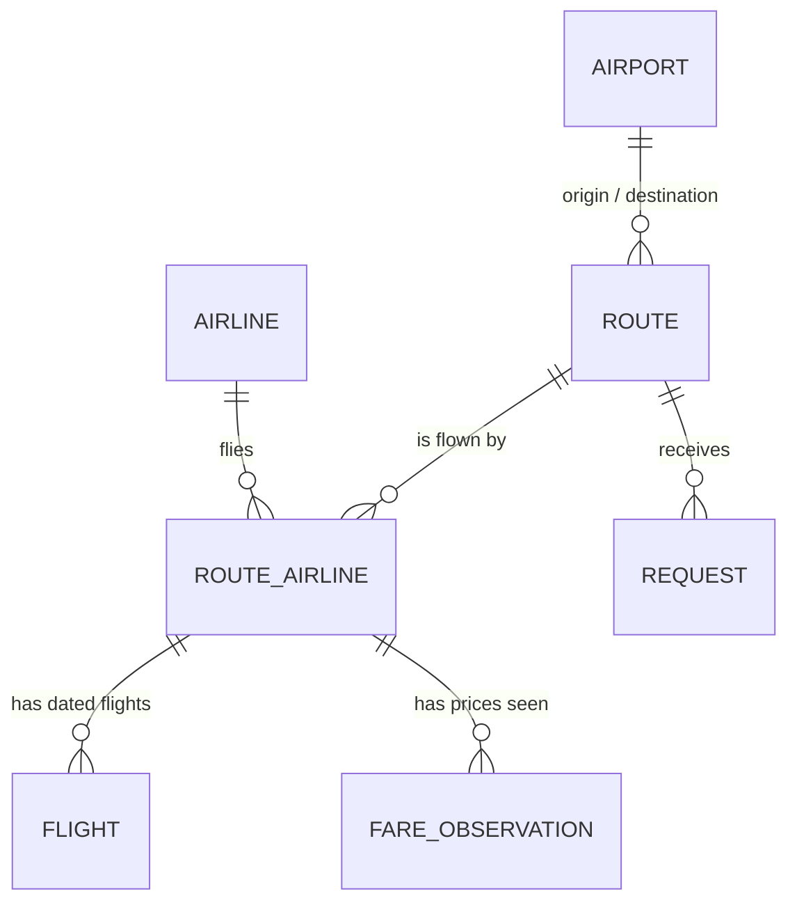

# Route-centric model and back office

> **Status:** proposal for owner review, 2026-10-30. Nothing in this document is built yet.
> **Replaces:** the "flight pattern" way of managing schedules.
> **Plan:** phases **RW-1 → RW-7** below. They form milestone **M3** in [PLAN.md](PLAN.md#7-milestones).
> **Depends on:** [DESIGN-SYSTEM.md](DESIGN-SYSTEM.md) (done) and [SEO-AEO-GEO.md](SEO-AEO-GEO.md) (rules for public pages).

**Contents**
1. [Summary](#1-summary)
2. [What hurts today](#2-what-hurts-today)
3. [What the real data looks like](#3-what-the-real-data-looks-like)
4. [The model](#4-the-model)
5. [Design choices and alternatives](#5-design-choices-and-alternatives)
6. [The back office: managing a route](#6-the-back-office-managing-a-route)
7. [What the public site shows](#7-what-the-public-site-shows)
8. [Which routes first](#8-which-routes-first)
9. [Moving from today's data](#9-moving-from-todays-data)
10. [Phased plan](#10-phased-plan)
11. [Open questions for the owner](#11-open-questions-for-the-owner)
12. [Risks](#12-risks)

---

## 1. Summary

The owner's direction: **a route is the one permanent thing. Airlines, days, times, prices and stops all change around it.** Manage everything from the route, and let the public site follow the same shape.

**Where that is right:**
- The route (Kinshasa → Lubumbashi) is what travellers search for, what a page is about, what a request is for and what we prioritise. It should be the unit of management, of publication and of SEO.
- Prices must never live on a schedule. Every price change currently forces a new schedule record.
- Re-typing a whole schedule because the operating days changed is a tooling failure, not a data problem.

**Where it needs correcting:**
1. **A route alone cannot hold the data.** Under each route there must be three layers:
   - the airlines that fly it
   - the flights on actual dates
   - the prices seen

   "Route is unique" means the route is the **container and entry point**, not a single record with everything inside it.
2. **"Regardless of stops" is right for the route, wrong for the flight.** The route is the trip the traveller wants (Kinshasa to Kalemie). Each flight must still say whether it stops ("via Kindu"). Hiding stops would make us wrong on the routes people ask about most. The owner's own example, "prix kinshasa kalemie caa", is a route **CAA serves with a stop**.
3. **`/vols/kisangani-kinshasa/caa` is not an automatic win.**
   - It wins only when the page holds something the route page doesn't, which is the case on routes with two or more airlines.
   - When CAA is the only airline, that page would duplicate `/vols/kisangani-kinshasa`, compete with it, and fall under Google's doorway-page policy.
   - The rule in [§7](#7-what-the-public-site-shows) handles this. The route page still captures "caa" searches through its title.
4. **"Customised the way the airline presents itself" must stay structured.** Each airline gets free-text notes (baggage, fare names, how to book), but days, times, stops and prices go in fixed fields. Free-form content per route would break:
   - comparisons between airlines
   - the facts AI engines quote
   - automatic freshness checks
   - the future agency product

**The proposal in one sentence:** store **flights on actual dates** under **airline-on-route records** under **routes**. Give the operator a **calendar** to manage them, with bulk tools ("apply this schedule to these weeks", "copy this week"). Keep prices as dated observations beside the flights.

## 2. What hurts today

The current `FlightPattern` record mixes four different things in one row:

| Mixed into one row | Changes when… |
|---|---|
| The route (origin, destination) | Practically never |
| The airline's service on it (airline, flight number, aircraft) | Rarely |
| The timetable (days of the week, times, validity dates) | Every week or two |
| The price (`price`, deprecated in schema v2) | Several times a month (Air Congo) |

Because they share a row, a change in the fastest-moving thing forces a copy of everything. The owner's example:
- Air Congo flies Mon / Wed / Sat this week and Tue / Thu / Sun for the next two weeks. That means two full patterns with the flight number, times and aircraft typed twice.
- Then the price changes, which means more copies.

There is a second, quieter failure. **When nobody re-enters a pattern, it expires and the route disappears from the site.**
- That is what happened: all 30 production patterns ended on 2026-02-28, and the public site has shown no flights since.
- There is no "last known" state, no warning and no freshness signal. The model has no idea of *when data was last confirmed*.

## 3. What the real data looks like

All of the following was checked on 2026-10-30.

**Schedules change weekly.**
- CAA publishes a new timetable PDF every week. The current file is named `horaires-20-oct.pdf`, starts on 20/10/2026 and was last modified on 26/10/2026.
- So the natural unit of change is **a week of flights**, not a validity period.

**One flight number serves several routes.** From CAA's timetable for the week of 20 Oct:
- BU 1433/1434 links Kinshasa, Mbuji-Mayi, Kolwezi and Lubumbashi.
- Kinshasa–Kalemie is served through Kindu.

From AeroRoutes (April 2026), Air Congo's regional flights also make several stops:
- Kisangani–Kindu–Kalemie–Lubumbashi
- Kisangani–Isiro–Bunia

**Air Congo sells under Ethiopian flight numbers.** Cirium's FlightStats site lists Air Congo's domestic flights as **ET 60 / ET 62** (Kinshasa → Lubumbashi), **ET 70** (→ Kisangani) and so on, not under 4H. **The flight number is not derived from the airline code.** It is stored as written.

**Cross-check:** on 30 and 31 Oct, FlightStats lists CAA BU 1611 Kinshasa → Lubumbashi 13:45 → 17:15. That matches the CAA PDF.

**Prices move independently of schedules.** Air Congo's homepage shows "From USD" fares that change without any schedule change.

**A few routes carry most of the flights.** These are CAA departures per week, both directions combined, counted from the timetable of 20 Oct 2026. They are approximate because the PDF text is partly scrambled.

| Route (both directions) | CAA flights / week |
|---|---|
| Kinshasa – Lubumbashi | 16 |
| Kolwezi – Lubumbashi | 10 |
| Kinshasa – Mbuji-Mayi | 8 |
| Kinshasa – Kolwezi | 6 |
| Kinshasa – Mbandaka | 6 |
| Kinshasa – Kisangani | 6 |
| Lubumbashi – Mbuji-Mayi, Kolwezi – Mbuji-Mayi, Kananga – Kinshasa, Kindu – Kinshasa, Kalemie – Kindu, Kalemie – Lubumbashi | 4 each |
| Kindu – Kisangani | 2 |

Air Congo adds to the top routes: Kinshasa → Lubumbashi, Mbuji-Mayi, Kisangani and Muanda (FlightStats, 30 Oct).

## 4. The model



| Entity | What it is | Example | Changes |
|---|---|---|---|
| **Route** | A trip from one city to another, in one direction. Unique. | Kinshasa → Lubumbashi (`kinshasa-lubumbashi`) | Created once; status and priority change rarely |
| **RouteAirline** | One airline on one route. This is what `/vols/…/caa` is about. | CAA on Kinshasa → Lubumbashi | When an airline starts or stops a route |
| **Flight** | One departure on one date. | 3 Nov 2026, BU 1611, 13:45 → 17:15, direct | Weekly, by the operator or an import |
| **FareObservation** | One price seen at one moment (exists since schema v2). | 244 $, Economy, seen 30 Oct on air-congo.com | Whenever a price is seen |
| **ChangeLog** | Who changed what, and when (plan item S-5). | "Copied week of 2 Nov to 9 and 16 Nov" | Every write |

### Fields (proposed schema v3)

**Route**: adds to the existing table:
- `status`: `DRAFT | PUBLISHED | ARCHIVED`. It replaces `isPublished`.
- `tier`: 1, 2 or 3. Priority, see [§8](#8-which-routes-first).
- `note`: a short, human-written editorial note in French.

The slug (`kinshasa-lubumbashi`) and the unique origin + destination pair already exist.

**RouteAirline**:
- `routeId`, `airlineId`. Unique together.
- `status`: `ACTIVE | SUSPENDED | ENDED`.
- `isPublished`.
- `note`: baggage, fare names, how to book.
- `bookingUrl`: overrides the airline's default.
- `verifiedAt` and `verifiedSourceUrl`: the last time someone checked the airline's own information for this route, **even when nothing changed**.

**Flight**:

| Field | Meaning |
|---|---|
| `routeAirlineId` | Which airline-on-route it belongs to. |
| `date` | Departure date, local at the origin (date only). |
| `flightNumber` | Stored as written: `BU1611`, `ET60`. |
| `departureTime`, `arrivalTime`, `arrivalDayOffset` | Local times at each airport; the offset is 0 or 1. |
| `via` | Ordered list of stop codes, e.g. `["KND"]`. Empty means direct. |
| `aircraft` | Optional. |
| `status` | `SCHEDULED | CANCELLED`. |
| `source`, `sourceUrl`, `verifiedAt`, `reviewStatus` | Where it came from and how sure we are. Operator entries are `APPROVED`; imports start `PENDING`. |
| `batchId` | Which bulk action created it, so that action can be undone. |

There is **one row per route-airline, date and flight number** (enforced unique).

**FareObservation**: adds:
- `routeAirlineId`
- `fareName` (e.g. "Economy Classic")
- optionally the `flightNumber` the price was seen for

**Request**: adds `routeId`, so every request counts as demand for a route.

**Computed, never stored:**
- the weekly pattern (e.g. "lun., mer. et sam.", from the next 28 days)
- the next departure
- "known until" (the last date we have flights for)
- flights per week
- duration (from local times and the two airports' timezones)
- the lowest recent price
- freshness

Storing these would let them go stale.

**Size:** at the target scope this is about 10 top route pairs × 2 directions × 1–2 airlines × about 4 flights a week × 8 weeks. That is **roughly 1,000 flight rows**, which is trivial for Postgres.

## 5. Design choices and alternatives

### 5.1 How to store schedules: flights on dates (chosen)

| Option | How | For | Against |
|---|---|---|---|
| A. Patterns with validity periods (today) | "Mon/Wed/Sat from 1 to 7 Nov" | Compact; matches printed timetables | Any irregularity means splitting periods. A one-off cancellation needs a new period. This is the pain the owner described. |
| B. Pattern plus exceptions (the model used by public-transport feeds, GTFS) | Weekly template plus "not on 4 Nov" and "also on 6 Nov" | Compact and handles exceptions | Two places define the truth. Editing the template after adding exceptions creates conflicts that are hard to explain in an interface. |
| **C. Flights on dates, with patterns as an input tool** ✅ | One row per departure. "Apply Mon/Wed/Sat 07:45 from 1 to 21 Nov" creates the rows. | **What you see is what is stored.** Exceptions are just edits. It matches the weekly PDF, airline calendars and future data feeds. "Known until" is honest. | Needs good bulk tools. Those are the back office's job, see [§6](#6-the-back-office-managing-a-route). |

With option C, the owner's example takes two actions and no duplicated typing:
1. Apply Mon/Wed/Sat to week 1.
2. Apply Tue/Thu/Sun to weeks 2–3.

The flight number, times and aircraft are typed once; the second action starts from the first. A price change touches no flight at all.

### 5.2 Directions: one route per direction (recommended, ❓ owner to confirm)
Kinshasa → Lubumbashi and Lubumbashi → Kinshasa have different flight numbers, times, sometimes prices, and different searches. They are two routes and two pages, each showing a short summary of the return trip with a link to it.

The back office shows both directions side by side, because they are usually managed together.
- **Alternative:** one page per city pair covering both directions. That means fewer pages but mixed content, and the URL can't match the direction people search in. Not recommended.

### 5.3 Stops: the route is the trip, the flight carries the stops
- A flight Kinshasa → Kalemie via Kindu is stored under the route **Kinshasa → Kalemie** with `via = ["KND"]`. It is shown as "1 escale (Kindu)".
- The same flight number also serves Kinshasa → Kindu and Kindu → Kalemie. Entered by hand, it is typed under each route it serves.
- Phase **RW-6** adds a helper: "this flight also serves…", which proposes the same flight on the sub-routes.
- Changing planes between two different flights (a connection) is **out of scope for v1**. A route without a single-flight option can say "pas de vol direct ; correspondance possible via Lubumbashi" in its editorial note.

### 5.4 Prices: observations next to the flights
- Already decided in schema v2: prices are dated observations, never a field of a schedule.
- They now hang from the airline-on-route record. They can optionally point to a travel date and a flight number, when the airline shows a price for a specific flight.
- The "current price" shown publicly is computed: the **latest approved observation for each fare name or cabin, no older than N days**. N comes from plan item R-3.
- The full history is kept and later becomes the price-history chart (P-7) and the price archive (F-8).

### 5.5 Freshness is first-class
There are two timestamps:
- `Flight.verifiedAt`: this departure was confirmed.
- `RouteAirline.verifiedAt`: someone checked this airline's information for this route, **even if nothing changed**.

A "Tout est vérifié" button stamps both in one click. The public page shows "Vérifié le …", and the back office sorts routes by staleness. That is what keeps a one-person operation honest.

### 5.6 Publication and priority
- A route has a status (draft, published, archived) and a tier (1–3).
- An airline-on-route is published separately, so a new airline can be prepared without showing half-entered data.
- The rules for what becomes a public page are in [§7](#7-what-the-public-site-shows).

### 5.7 What we drop
- `FlightPattern` as a way of managing schedules. Its rows are kept, read-only, as "last known schedule" hints (see [§9](#9-moving-from-todays-data)), then removed in RW-7.
- Prices on schedules. The `price` column was already marked deprecated.

## 6. The back office: managing a route

It is designed for a desktop screen, in French, and keyboard-friendly ([DESIGN-SYSTEM.md §10](DESIGN-SYSTEM.md#10-public-site-vs-back-office)).

### 6.1 Network board: `/dashboard/routes`
This is the daily starting point: **what needs attention today**.

```
Routes                                                     [+ Nouvelle route]
Filtrer: [Toutes ▾] [P1 ▾] [À revérifier ▾]          Rechercher: [kinshasa…]

Route                       P   Compagnies     Prochain vol   Connu jusqu'au  Fraîcheur          Prix   Publiée
Kinshasa → Kalemie          1   BU (via KND)   mer. 4 nov.    8 nov.          ● Ancien · 30 j    —      Non
Kinshasa → Mbuji-Mayi       1   BU · ET        lun. 2 nov.    15 nov.         ● À revérifier 10 j 1      Oui
Kinshasa → Lubumbashi       1   BU · ET        mar. 3 nov.    22 nov.         ● Vérifié il y a 2 j 3     Oui
…
```
- It is sorted by "needs attention": stale first, then tier.
- Each row shows both directions on hover, and opens the route workspace.

### 6.2 Route workspace: `/dashboard/routes/kinshasa-lubumbashi`

```
┌────────────┬──────────────────────────────────────────────────────────────────────────┐
│ clerikaa   │ Routes › Kinshasa → Lubumbashi           [⇄ Lubumbashi → Kinshasa]        │
│            │ P1 · Publiée · /vols/kinshasa-lubumbashi ↗                                │
│ Routes     │                                                                           │
│ Demandes   │ [ CAA · BU ] [ Air Congo · ET ] [ + Ajouter une compagnie ]               │
│ Compagnies │ ─────────────────────────────────────────────────────────────────────────│
│ Aéroports  │ Vérifié il y a 2 j · connu jusqu'au 22 nov.        [✓ Tout est vérifié]   │
│ Design     │                                                                           │
│            │ Semaine      lun     mar     mer     jeu     ven     sam     dim          │
│            │ 2–8 nov     1671    1611    1611    1611    1611     ·       ·            │
│            │             16:30   13:45   13:45   13:45   13:45                         │
│            │ 9–15 nov    1671    1611    1611  ✕1611    1611     ·       ·            │
│            │ 16–22 nov   1671    1611    1611    1611    1611     ·       ·            │
│            │ 23–29 nov    ·       ·       ·       ·       ·       ·       ·            │
│            │ [Appliquer un horaire]  [Copier une semaine →]  [Annuler des vols]        │
│            │                                                                           │
│            │ Prix observés                                          [+ Prix observé]   │
│            │ 260 $  Économie     observé 27 oct.   caacongo.com        Validé          │
│            │ 255 $  Économie     observé 12 oct.   agence (tél.)       Validé          │
│            │                                                                           │
│            │ Notes (publiques)                                                         │
│            │ « Bagages : 23 kg en soute… »                                             │
│            │ Historique ▸                                                              │
└────────────┴──────────────────────────────────────────────────────────────────────────┘
```

**Tools**
| Tool | What it does | Replaces today's… |
|---|---|---|
| **Click a day** | Add or edit the flight(s) on that date | Creating a whole pattern |
| **Appliquer un horaire** | Flight number, days, times, stops and date range create all matching flights. A preview shows what will be added or changed before saving. | Creating a pattern |
| **Copier une semaine** | Copies a week to the next N weeks, skipping days that already have flights | Re-creating patterns |
| **Annuler des vols** | Marks selected flights as cancelled. The history is kept. | Editing end dates |
| **Tout est vérifié** | Stamps today's date on the airline-on-route and its next 14 days of flights | Nothing (did not exist) |
| **+ Prix observé** | Amount, fare name and source URL. The observed date defaults to today, and the travel date is optional. 3 fields, under 20 seconds. | Creating a pattern with a new price |
| **Undo** | Every bulk action can be undone as a whole (`batchId`) | Nothing |
| **Historique** | The ChangeLog for this route | Nothing |

**Owner's example, step by step (exit test for RW-3):**
1. Open Kinshasa → Lubumbashi and select the Air Congo tab.
2. Choose *Appliquer un horaire*: ET 60, Mon / Wed / Sat, 08:00 → 11:30, 2–8 Nov. Preview, then save.
3. *Appliquer un horaire* again. The form is pre-filled from the last one; change the days to Tue / Thu / Sun and the dates to 9–22 Nov. Save.
4. Price changed? Choose *+ Prix observé*: 244, Economy, air-congo.com link. Save. No flight is touched.

**Daily routine target: under 15 minutes.**
1. Open the board.
2. Take the top stale routes.
3. Compare each with the airline's site or timetable, and fix or copy a week.
4. Click *Tout est vérifié*.
5. Log any new price.

### 6.3 Imports and partners later use the same screen
- The CAA timetable importer, if it is ever built (C-2, now paused), and any partner feed (C-7 / C-8) will write **proposed** flights (`PENDING`).
- The workspace shows them as ghost cells beside the current flights. The operator approves or rejects them, by week or one by one.
- So the manual tools built now are **not throwaway**: they become the review screen for automated data.

## 7. What the public site shows

The URLs follow the French-first decision in [SEO-AEO-GEO.md](SEO-AEO-GEO.md#3-urls-and-site-structure).

| Page | URL | Exists when |
|---|---|---|
| Routes hub | `/vols` | Always: lists published routes by departure city |
| Route | `/vols/kinshasa-lubumbashi` | The route is `PUBLISHED` **and** it has at least one future flight **or** an approved price under 30 days old **or** an airport-status notice (e.g. Goma closed) |
| Route + airline | `/vols/kinshasa-lubumbashi/caa` | The route page exists, **and** the route has **2 or more** published airlines, **and** this airline has future flights or a recent price. Otherwise the URL permanently redirects to the route page. |
| Airline | `/compagnies/caa` | The airline is published |
| Airport | `/aeroports/kinshasa` | The airport has at least one published route, or a status notice |
| Network status | `/etat-du-reseau` | Always: closed airports, suspended airlines, with sources |

**Why the route + airline rule.**
- When CAA is the only airline on Kinshasa → Kalemie, a CAA page would repeat the route page.
- Instead, the route page title names the airline: "Vols Kinshasa – Kalemie (CAA) : horaires et prix". That captures "prix kinshasa kalemie caa" without a duplicate page.
- The airline page appears automatically the day a second airline starts the route.

**What happens to a stale route.**
- A published route with no future flight and no recent price is not deleted.
- It shows "Horaires non confirmés depuis le …" and is set to `noindex` until it is refreshed.
- This replaces today's behaviour, where expired data simply vanished.

**Route page: blocks, top to bottom, each fed by the model**
| Block | Content | From |
|---|---|---|
| Answer | One sentence: who flies, how often, from what price, as of when. "2 compagnies (CAA, Air Congo) · 9 vols par semaine · dès 244 $ (observé le 30 oct.)" | Computed |
| Status banners | Airport closed or restricted; airline suspended | Airport, Airline |
| Next departures | Next 14 days: date, airline, flight, times, stops | Flight |
| Weekly pattern | Per airline: day strip, usual times, flight numbers | Computed from Flight |
| Prices | Per airline and fare: amount, observation date, source | FareObservation |
| Return trip | Short summary of the return route, with a link | Reverse Route |
| About this route | Editorial note; airport names; time difference | Route.note, Airport |
| Sources and freshness | "Vérifié le …", source links | verifiedAt, sourceUrl |
| Request | "Demander un devis" form, linked to the route | Request |

## 8. Which routes first

The owner said it: **we don't need every route, only the ones people search for.** This is also what keeps us within Google's spam policies.

**Initial proposal** (❓ owner to confirm). It is based on CAA frequencies ([§3](#3-what-the-real-data-looks-like)), Air Congo's network, Air Congo's advertised fares and the owner's tracked searches. Each line is a city pair, with both directions included.

| Tier | Routes | Why |
|---|---|---|
| **P1** (first) | Kinshasa – Lubumbashi · Kinshasa – Mbuji-Mayi · Kinshasa – Kisangani · Kinshasa – Kolwezi · Kinshasa – Kananga · Kinshasa – Mbandaka · Kolwezi – Lubumbashi · Kinshasa – Kalemie · Kinshasa – Kindu | Highest frequencies; both airlines on most; Kalemie is a tracked search |
| **P2** | Lubumbashi – Mbuji-Mayi · Lubumbashi – Kalemie · Kindu – Kalemie · Kinshasa – Muanda · Kinshasa – Gemena · Kisangani – Kindu | Regular but thinner service |
| **Status pages** | Kinshasa – Goma · Bunia – Beni | Airports closed (Goma since Jan 2025; Bunia since 6 Jun 2026). People still search ("Prix avion Bunia Beni"); an accurate status page is the useful answer. |

That is 9 P1 pairs, or 18 directional routes. M3's exit test asks for at least 10 of them live; reaching all 18 comes later in M4.

**How tiers get updated:**
- requests per route (the request form becomes linked to routes)
- Search Console impressions once the pages are live
- airline frequency

They are reviewed monthly.

## 9. Moving from today's data

| Today | Becomes | Note |
|---|---|---|
| `Route` (backfilled in schema v2, unpublished) | `Route` with `status = DRAFT` and a tier | Nothing lost |
| `FlightPattern` (30 rows in production, all expired 2026-02-28) | A `RouteAirline` for each route and airline pair found, unpublished. The patterns stay read-only as "dernier programme connu" hints that pre-fill *Appliquer un horaire*. | **No future flights are invented** from expired patterns |
| `FareObservation` (35 pending) | Linked to its `RouteAirline`; routes are created if missing (e.g. Kinshasa → Muanda) | Review status kept |
| `Request` (free-text cities) | Matched to a route when the cities match | Others stay unmatched |
| `/explore`, `/explore/[flightNumber]` | Replaced by `/vols/...` with permanent (301) redirects | RW-7 |
| Air Congo flight numbers | Stored as `ET…` under Air Congo | Never inferred from the 4H code |

## 10. Phased plan

Each phase is one PR, off `main`, never stacked. Each has an exit test. The IDs are tracked in [PLAN.md](PLAN.md).

| ID | Phase | Contents | Exit test | Status |
|---|---|---|---|---|
| **RW-1** | Schema v3 | `RouteAirline`, `Flight`, `ChangeLog`; route status, tier and notes; fare and request links; migration of existing data (§9); unit tests for the constraints | The dev database migrates cleanly. Duplicate flights are rejected. Existing patterns and fares are attached to the right route and airline. | ⬜ next |
| **RW-2** | Network board | `/dashboard/routes`: list, filters, computed next flight, "known until" and freshness; create a route (pick two airports, slug generated) | All draft and published routes are listed with correct computed values. A new route can be created in under 30 seconds. | ⬜ |
| **RW-3** | Route workspace: schedules | Calendar (8 weeks × 7 days), click to edit, *Appliquer un horaire* with preview, *Copier une semaine*, *Annuler*, *Tout est vérifié*, undo by batch, both directions | The owner's example (§6.2) is done in under 2 minutes with no repeated typing. Undo restores the previous state. | ⬜ |
| **RW-4** | Route workspace: prices and notes | *+ Prix observé* (3 fields), price list per airline, editorial notes, history panel; operator entries auto-approved; pending imports shown separately | A price change is logged in under 20 seconds. The 35 pending fares can be reviewed from the workspace. | ⬜ |
| **RW-5** | Public route pages | `/vols`, `/vols/[route]`, `/vols/[route]/[airline]` rendered on the server from the model, following [SEO-AEO-GEO.md](SEO-AEO-GEO.md); sitemap from the database; request form linked to routes | P1 routes with real data are live, pass the page checklist and appear in the sitemap. | ⬜ |
| **RW-6** | Helpers | "Also serves" for flights with stops; copy to the return route; keyboard shortcuts; bulk verify | Entering a flight with a stop on all three routes it serves takes one action. | ⬜ |
| **RW-7** | Clean-up | Remove `FlightPattern` screens and API, the old `/explore` pages (with 301s) and the `price` column (S-3) | No code reads `FlightPattern`. Old URLs redirect. | ⬜ |

The order is deliberate. The owner works in the back office (RW-1 → RW-4) before anything public changes (RW-5), so the public pages launch with real, fresh data.

## 11. Open questions for the owner

1. **One page per direction** (§5.2): recommended. Confirm?
2. **P1 route list** (§8): add or remove any routes?
3. **Route + airline pages only when a route has 2+ airlines** (§7): confirm?
4. **Status pages for closed airports** (Kinshasa – Goma, Bunia – Beni): publish them?
5. **Default verification window:** should *Tout est vérifié* stamp the next 14 days of flights, or the next 7?

## 12. Risks

| Risk | Mitigation |
|---|---|
| The calendar is more work to build than a form | Phased: RW-3 ships the minimum tools (apply, copy, cancel, verify); helpers come in RW-6. |
| Flights with stops are typed several times by hand | Accepted for v1 (few such routes); "also serves" helper in RW-6. |
| The data goes stale while the owner is away | Freshness on the board; stale pages become `noindex` instead of showing wrong data; the daily routine is under 15 minutes. |
| Flight numbers differ between sources (4H vs ET) | Stored as written, and the source is kept with each flight. |
| Public pages launch before data is fresh | RW-5 comes after the back office; publishing needs data that passes §7. |
