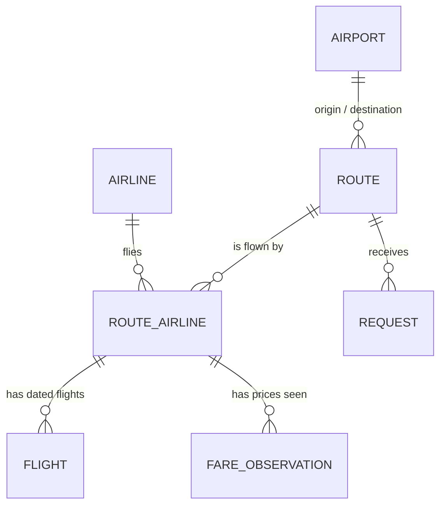

# Route-centric model and back office

> **Status:** proposal 2026-10-30; the owner answered the open questions on 2026-10-31 ([§11](#11-open-questions-for-the-owner)). **RW-1 (schema v3, [§4](#4-the-model))** and **RW-2 (network board, [§6.1](#61-network-board-dashboardroutes))** are live (PR #8, #9). **RW-3 and RW-4 (schedules, prices, notes and history, [§6.2](#62-route-workspace-dashboardrouteskinshasa-lubumbashi))** are live too (PR #10, #12). Public route pages (RW-5) come after the back-office home (B-1 in PLAN.md).
> **Replaces:** the "flight pattern" way of managing schedules.
> **Plan:** phases **RW-1 → RW-7** below. They form milestone **M3** in [PLAN.md](PLAN.md#7-milestones).
> **Depends on:** [DESIGN-SYSTEM.md](DESIGN-SYSTEM.md) (done) and [SEO-AEO-GEO.md](SEO-AEO-GEO.md) (rules for public pages).

**Contents**
1. [Summary](#1-summary)
2. [What hurts today](#2-what-hurts-today)
3. [What the real data looks like](#3-what-the-real-data-looks-like)
4. [The model](#4-the-model)
5. [Design choices and alternatives](#5-design-choices-and-alternatives)
6. [The back office: managing a route](#6-the-back-office-managing-a-route)
7. [What the public site shows](#7-what-the-public-site-shows)
8. [Which routes first](#8-which-routes-first)
9. [Moving from today's data](#9-moving-from-todays-data)
10. [Phased plan](#10-phased-plan)
11. [Open questions for the owner](#11-open-questions-for-the-owner)
12. [Risks](#12-risks)

---

## 1. Summary

The owner's direction: **a route is the one permanent thing. Airlines, days, times, prices and stops all change around it.** Manage everything from the route, and let the public site follow the same shape.

**Where that is right:**
- The route (Kinshasa → Lubumbashi) is what travellers search for, what a page is about, what a request is for and what we prioritise. It should be the unit of management, of publication and of SEO.
- Prices must never live on a schedule. Every price change currently forces a new schedule record.
- Re-typing a whole schedule because the operating days changed is a tooling failure, not a data problem.

**Where it needs correcting:**
1. **A route alone cannot hold the data.** Under each route there must be three layers:
   - the airlines that fly it
   - the flights on actual dates
   - the prices seen

   "Route is unique" means the route is the **container and entry point**, not a single record with everything inside it.
2. **"Regardless of stops" is right for the route, wrong for the flight.** The route is the trip the traveller wants (Kinshasa to Kalemie). Each flight must still say whether it stops ("via Kindu"). Hiding stops would make us wrong on the routes people ask about most. The owner's own example, "prix kinshasa kalemie caa", is a route **CAA serves with a stop**.
3. **`/vols/kisangani-kinshasa/caa` must hold something the route page doesn't.**
   - *Proposal (2026-10-30):* create it only when 2 or more airlines fly the route, to avoid a near-copy of the route page.
   - *Decision (owner, 2026-10-31):* **every airline on a route gets its page, even when it is the only one.** The route page compares 0 to N airlines; the airline page is one airline's full breakdown. A page that appears and disappears with the number of airlines would confuse crawlers and visitors.
   - I agree: URL stability beats the duplication risk, as long as the two pages carry different content. That rule is in [§7](#7-what-the-public-site-shows).
4. **"Customised the way the airline presents itself" must stay structured.** Each airline gets free-text notes (baggage, fare names, how to book), but days, times, stops and prices go in fixed fields. Free-form content per route would break:
   - comparisons between airlines
   - the facts AI engines quote
   - automatic freshness checks
   - the future agency product

**The proposal in one sentence:** store **flights on actual dates** under **airline-on-route records** under **routes**. Give the operator a **calendar** to manage them, with bulk tools ("apply this schedule to these weeks", "copy this week"). Keep prices as dated observations beside the flights.

## 2. What hurts today

The current `FlightPattern` record mixes four different things in one row:

| Mixed into one row | Changes when… |
|---|---|
| The route (origin, destination) | Practically never |
| The airline's service on it (airline, flight number, aircraft) | Rarely |
| The timetable (days of the week, times, validity dates) | Every week or two |
| The price (`price`, deprecated in schema v2) | Several times a month (Air Congo) |

Because they share a row, a change in the fastest-moving thing forces a copy of everything. The owner's example:
- Air Congo flies Mon / Wed / Sat this week and Tue / Thu / Sun for the next two weeks. That means two full patterns with the flight number, times and aircraft typed twice.
- Then the price changes, which means more copies.

There is a second, quieter failure. **When nobody re-enters a pattern, it expires and the route disappears from the site.**
- That is what happened: all 30 production patterns ended on 2026-02-28, and the public site has shown no flights since.
- There is no "last known" state, no warning and no freshness signal. The model has no idea of *when data was last confirmed*.

## 3. What the real data looks like

All of the following was checked on 2026-10-30.

**Schedules change weekly.**
- CAA publishes a new timetable PDF every week. The current file is named `horaires-20-oct.pdf`, starts on 20/10/2026 and was last modified on 26/10/2026.
- So the natural unit of change is **a week of flights**, not a validity period.

**One flight number serves several routes.** From CAA's timetable for the week of 20 Oct:
- BU 1433/1434 links Kinshasa, Mbuji-Mayi, Kolwezi and Lubumbashi.
- Kinshasa–Kalemie is served through Kindu.

From AeroRoutes (April 2026), Air Congo's regional flights also make several stops:
- Kisangani–Kindu–Kalemie–Lubumbashi
- Kisangani–Isiro–Bunia

**Air Congo sells under Ethiopian flight numbers.** Cirium's FlightStats site lists Air Congo's domestic flights as **ET 60 / ET 62** (Kinshasa → Lubumbashi), **ET 70** (→ Kisangani) and so on, not under 4H. **The flight number is not derived from the airline code.** It is stored as written.

**Cross-check:** on 30 and 31 Oct, FlightStats lists CAA BU 1611 Kinshasa → Lubumbashi 13:45 → 17:15. That matches the CAA PDF.

**Prices move independently of schedules.** Air Congo's homepage shows "From USD" fares that change without any schedule change.

**A few routes carry most of the flights.** These are CAA departures per week, both directions combined, counted from the timetable of 20 Oct 2026. They are approximate because the PDF text is partly scrambled.

| Route (both directions) | CAA flights / week |
|---|---|
| Kinshasa – Lubumbashi | 16 |
| Kolwezi – Lubumbashi | 10 |
| Kinshasa – Mbuji-Mayi | 8 |
| Kinshasa – Kolwezi | 6 |
| Kinshasa – Mbandaka | 6 |
| Kinshasa – Kisangani | 6 |
| Lubumbashi – Mbuji-Mayi, Kolwezi – Mbuji-Mayi, Kananga – Kinshasa, Kindu – Kinshasa, Kalemie – Kindu, Kalemie – Lubumbashi | 4 each |
| Kindu – Kisangani | 2 |

Air Congo adds to the top routes: Kinshasa → Lubumbashi, Mbuji-Mayi, Kisangani and Muanda (FlightStats, 30 Oct).

## 4. The model



| Entity | What it is | Example | Changes |
|---|---|---|---|
| **Route** | A trip from one city to another, in one direction. Unique. | Kinshasa → Lubumbashi (`kinshasa-lubumbashi`) | Created once; status and priority change rarely |
| **RouteAirline** | One airline on one route. This is what `/vols/…/caa` is about. | CAA on Kinshasa → Lubumbashi | When an airline starts or stops a route |
| **Flight** | One departure on one date. | 3 Nov 2026, BU 1611, 13:45 → 17:15, direct | Weekly, by the operator or an import |
| **FareObservation** | One price seen at one moment (exists since schema v2). | 244 $, Economy, seen 30 Oct on air-congo.com | Whenever a price is seen |
| **ChangeLog** | Who changed what, and when (plan item S-5): actor, record, action, the route it concerns, the batch, a one-line summary and the changed fields with their old and new values. | "Copied week of 2 Nov to 9 and 16 Nov" | Every write, in the same transaction |

### Fields (proposed schema v3)

**Route**: adds to the existing table:
- `status`: `DRAFT | PUBLISHED | ARCHIVED`. It replaces `isPublished`.
- `tier`: 1, 2 or 3 (default 3). Priority, see [§8](#8-which-routes-first).
- `note`: a short, human-written editorial note in French.
- The database refuses a route from an airport to itself.

The slug (`kinshasa-lubumbashi`) and the unique origin + destination pair already exist.

**RouteAirline**:
- `routeId`, `airlineId`. Unique together.
- `status`: `ACTIVE | SUSPENDED | ENDED`.
- `isPublished`.
- `note`: baggage, fare names, how to book.
- `bookingUrl`: overrides the airline's default.
- `verifiedAt` and `verifiedSourceUrl`: the last time someone checked the airline's own information for this route, **even when nothing changed**.

**Flight**:

| Field | Meaning |
|---|---|
| `routeAirlineId` | Which airline-on-route it belongs to. |
| `date` | Departure date, local at the origin (date only). |
| `flightNumber` | Stored as written, uppercase without spaces: `BU1611`, `ET60`. Empty when the airline publishes none (Air Congo's timetable PDF). |
| `departureTime`, `arrivalTime`, `arrivalDayOffset` | Local times at each airport; the offset is 0 or 1. |
| `via` | Ordered list of stop codes, e.g. `["KND"]`. Empty means direct. |
| `aircraft` | Optional. |
| `status` | `SCHEDULED | CANCELLED`. |
| `source`, `sourceUrl`, `verifiedAt`, `reviewStatus` | Where it came from and how sure we are. Operator entries are `APPROVED`; imports start `PENDING`. |
| `batchId` | Which bulk action created it, so that action can be undone. |

There is **one row per route-airline, date and flight number**, and **one per route-airline, date and departure time**. Both are enforced by the database. The second rule is needed because a flight number can be empty: two unnumbered flights are told apart by their time (decided in RW-1).

The database also checks the written forms: times `HH:MM`, an arrival day offset of 0 or 1, flight numbers like `BU1611`, stops as airport codes.

**FareObservation**: adds:
- `routeAirlineId`
- `fareName` (e.g. "Economy Classic")
- optionally the `flightNumber` the price was seen for

Its own airline, origin and destination columns are dropped: the airline-on-route carries them (RW-1).

**Request**: adds `routeId`, so every request counts as demand for a route.

**Computed, never stored:**
- the weekly pattern (e.g. "lun., mer. et sam.", from the next 28 days)
- the next departure
- "known until" (the last date we have flights for)
- flights per week
- duration (from local times and the two airports' timezones)
- the lowest recent price
- freshness

Storing these would let them go stale.

**Size:** at the target scope this is about 10 top route pairs × 2 directions × 1–2 airlines × about 4 flights a week × 8 weeks. That is **roughly 1,000 flight rows**, which is trivial for Postgres.

## 5. Design choices and alternatives

### 5.1 How to store schedules: flights on dates (chosen)

| Option | How | For | Against |
|---|---|---|---|
| A. Patterns with validity periods (today) | "Mon/Wed/Sat from 1 to 7 Nov" | Compact; matches printed timetables | Any irregularity means splitting periods. A one-off cancellation needs a new period. This is the pain the owner described. |
| B. Pattern plus exceptions (the model used by public-transport feeds, GTFS) | Weekly template plus "not on 4 Nov" and "also on 6 Nov" | Compact and handles exceptions | Two places define the truth. Editing the template after adding exceptions creates conflicts that are hard to explain in an interface. |
| **C. Flights on dates, with patterns as an input tool** ✅ | One row per departure. "Apply Mon/Wed/Sat 07:45 from 1 to 21 Nov" creates the rows. | **What you see is what is stored.** Exceptions are just edits. It matches the weekly PDF, airline calendars and future data feeds. "Known until" is honest. | Needs good bulk tools. Those are the back office's job, see [§6](#6-the-back-office-managing-a-route). |

With option C, the owner's example takes two actions and no duplicated typing:
1. Apply Mon/Wed/Sat to week 1.
2. Apply Tue/Thu/Sun to weeks 2–3.

The flight number, times and aircraft are typed once; the second action starts from the first. A price change touches no flight at all.

### 5.2 Directions: one route per direction (confirmed by the owner, 2026-10-31)
Kinshasa → Lubumbashi and Lubumbashi → Kinshasa have different flight numbers, times, sometimes prices, and different searches. They are two routes and two pages, each showing a short summary of the return trip with a link to it.

The back office shows both directions side by side, because they are usually managed together.
- **Alternative:** one page per city pair covering both directions. That means fewer pages but mixed content, and the URL can't match the direction people search in. Not recommended.

### 5.3 Stops: the route is the trip, the flight carries the stops
- A flight Kinshasa → Kalemie via Kindu is stored under the route **Kinshasa → Kalemie** with `via = ["KND"]`. It is shown as "1 escale (Kindu)".
- The same flight number also serves Kinshasa → Kindu and Kindu → Kalemie. Entered by hand, it is typed under each route it serves.
- Phase **RW-6** adds a helper: "this flight also serves…", which proposes the same flight on the sub-routes.
- Changing planes between two different flights (a connection) is **out of scope for v1**. A route without a single-flight option can say "pas de vol direct ; correspondance possible via Lubumbashi" in its editorial note.

### 5.4 Prices: observations next to the flights
- Already decided in schema v2: prices are dated observations, never a field of a schedule.
- They now hang from the airline-on-route record. They can optionally point to a travel date and a flight number, when the airline shows a price for a specific flight.
- The "current price" shown publicly is computed: the **latest approved observation for each fare name or cabin, no older than N days**. N comes from plan item R-3.
- The full history is kept and later becomes the price-history chart (P-7) and the price archive (F-8).

### 5.5 Freshness is first-class
There are two timestamps:
- `Flight.verifiedAt`: this departure was confirmed.
- `RouteAirline.verifiedAt`: someone checked this airline's information for this route, **even if nothing changed**.

A "Tout est vérifié" button stamps both in one click. The public page shows "Vérifié le …", and the back office sorts routes by staleness. That is what keeps a one-person operation honest.

### 5.6 Publication and priority
- A route has a status (draft, published, archived) and a tier (1–3).
- An airline-on-route is published separately, so a new airline can be prepared without showing half-entered data.
- The rules for what becomes a public page are in [§7](#7-what-the-public-site-shows).

### 5.7 What we drop
- `FlightPattern` as a way of managing schedules. Its screens and API are gone (P-13) and the expired rows were deleted on the owner's request (2026-10-31); the table is dropped in RW-7.
- Prices on schedules. The `price` column was already marked deprecated.

## 6. The back office: managing a route

It is designed for a desktop screen, in French, and keyboard-friendly ([DESIGN-SYSTEM.md §10](DESIGN-SYSTEM.md#10-public-site-vs-back-office)).

### 6.1 Network board: `/dashboard/routes`
This is the daily starting point: **what needs attention today**.

```
Routes                                                     [+ Nouvelle route]
Filtrer: [Toutes ▾] [P1 ▾] [À revérifier ▾]          Rechercher: [kinshasa…]

Route                       P   Compagnies     Prochain vol   Connu jusqu'au  Fraîcheur          Prix   Publiée
Kinshasa → Kalemie          1   BU (via KND)   mer. 4 nov.    8 nov.          ● Ancien · 30 j    —      Non
Kinshasa → Mbuji-Mayi       1   BU · ET        lun. 2 nov.    15 nov.         ● À revérifier 10 j 1      Oui
Kinshasa → Lubumbashi       1   BU · ET        mar. 3 nov.    22 nov.         ● Vérifié il y a 2 j 3     Oui
…
```
- It is sorted by "needs attention": stale first, then tier.
- Each row shows both directions on hover, and opens the route workspace.

**Built in RW-2:**
- **Columns:** route (with a link to the return route and a badge when an airport is closed or restricted), priority, airlines (suspended or ended ones struck through), next flight with flights in the next 7 days, "connu jusqu'au", freshness, prices (validated, to validate), requests, status.
- **Order:**
  1. never checked or old
  2. to re-check
  3. no airline yet
  4. checked
  5. archived

  Then by priority, then by name.
- **Freshness of a route:** that of its least recently checked *active* airline. Every airline that flies it must be checked; suspended and ended airlines don't count.
  - Checked: up to 7 days ([§11](#11-open-questions-for-the-owner), question 5).
  - To re-check: 8 to 14 days.
  - Old: past 14 days.
- **Times:** "next flight" uses the local time at the origin airport.
- **Filters:** text (city, code, slug), status (archived routes hidden by default), priority, "à vérifier", "sans compagnie".
- **"Nouvelle route":** a dialog with two airports, a priority, and "créer aussi le retour" ticked by default. The slug comes from the airports. A route that already exists is reported, not duplicated.
- **The route page** (`/dashboard/routes/<slug>`) shows:
  - settings: status, priority, public note
  - the airlines on the route: verification, next flight, flights known
  - departures for the next 14 days, cancelled and pending ones included
  - the prices seen

  Flights are entered in RW-3 and prices in RW-4. Until then, those lists are read-only. A route can be deleted only while it is a draft with no airline and no request; otherwise it is archived.

### 6.2 Route workspace: `/dashboard/routes/kinshasa-lubumbashi`

```
┌────────────┬──────────────────────────────────────────────────────────────────────────┐
│ clerikaa   │ Routes › Kinshasa → Lubumbashi           [⇄ Lubumbashi → Kinshasa]        │
│            │ P1 · Publiée · /vols/kinshasa-lubumbashi ↗                                │
│ Routes     │                                                                           │
│ Demandes   │ [ CAA · BU ] [ Air Congo · ET ] [ + Ajouter une compagnie ]               │
│ Compagnies │ ─────────────────────────────────────────────────────────────────────────│
│ Aéroports  │ Vérifié il y a 2 j · connu jusqu'au 22 nov.        [✓ Tout est vérifié]   │
│ Design     │                                                                           │
│            │ Semaine      lun     mar     mer     jeu     ven     sam     dim          │
│            │ 2–8 nov     1671    1611    1611    1611    1611     ·       ·            │
│            │             16:30   13:45   13:45   13:45   13:45                         │
│            │ 9–15 nov    1671    1611    1611  ✕1611    1611     ·       ·            │
│            │ 16–22 nov   1671    1611    1611    1611    1611     ·       ·            │
│            │ 23–29 nov    ·       ·       ·       ·       ·       ·       ·            │
│            │ [Appliquer un horaire]  [Copier une semaine →]  [Annuler des vols]        │
│            │                                                                           │
│            │ Prix observés                                          [+ Prix observé]   │
│            │ 260 $  Économie     observé 27 oct.   caacongo.com        Validé          │
│            │ 255 $  Économie     observé 12 oct.   agence (tél.)       Validé          │
│            │                                                                           │
│            │ Notes (publiques)                                                         │
│            │ « Bagages : 23 kg en soute… »                                             │
│            │ Historique ▸                                                              │
└────────────┴──────────────────────────────────────────────────────────────────────────┘
```

**Tools**
| Tool | What it does | Replaces today's… |
|---|---|---|
| **Click a day** | Add or edit the flight(s) on that date | Creating a whole pattern |
| **Appliquer un horaire** | Flight number, days, times, stops and date range create all matching flights. A preview shows what will be added or changed before saving. | Creating a pattern |
| **Copier une semaine** | Copies a week to the next N weeks, skipping days that already have flights | Re-creating patterns |
| **Annuler des vols** | Marks selected flights as cancelled. The history is kept. | Editing end dates |
| **Tout est vérifié** | Stamps today's date on the airline-on-route and its next 7 days of flights ([§11](#11-open-questions-for-the-owner), question 5) | Nothing (did not exist) |
| **+ Prix observé** | Amount, fare name and source URL. The observed date defaults to today, and the travel date is optional. 3 fields, under 20 seconds. | Creating a pattern with a new price |
| **Undo** | Every bulk action can be undone as a whole (`batchId`) | Nothing |
| **Historique** | The ChangeLog for this route | Nothing |

**Built in RW-3** (the route page holds the workspace; the settings stay on the right):
- **Tabs:** one per airline on the route, plus *+ Ajouter une compagnie*, which starts it active and unpublished. The selected tab is in the address (`?compagnie=4H`), and *Même compagnie, sens retour* opens the same airline on the return route.
- **Calendar:** 8 weeks from the current one, moved 4 weeks at a time (`?semaine=`). Each day is a button that opens the day editor. Each week shows its flight count and a *copier* link.
- **Day editor:** the flights of one date as a list, with number, times, next-day arrival, stops, aircraft and "Prévu / Annulé". Saving replaces that date. A new flight is suggested from the same weekday a week earlier.
- **Previews:** *Appliquer un horaire*, *Copier une semaine* and *Annuler des vols* show a live preview (what is added, changed, already up to date, or skipped and why) before anything is saved.
- **Matching:** a flight is recognised by its number. Without a number, it is recognised by its departure time.
- **What is never overwritten:**
  - a cancelled flight stays cancelled
  - a time already taken by another flight is skipped
  - a copy never fills a day that already has flights
- **Verification:** *Appliquer un horaire* and the day editor mark flights verified, since they are typed from a source. Copies are not verified until *Tout est vérifié*.
- **Undo:** every action is one `ChangeBatch`, with a `ChangeLog` row per flight touched. *Défaire la dernière action* reverts the latest batch for that airline on the route, and can be repeated, like a stack. An undo is not itself undoable.
  - "Défaire" is used rather than "Annuler", which already means cancelling flights.

**Built in RW-4:**
- **Prices:** each airline tab has *Prix observés*.
  - **Entering:** *+ Prix observé* opens one row: amount, fare name, source link. Enter saves. The form stays open with the source kept for the next price.
  - **Optional details:** the date seen (today by default), a flight date (which makes it a price for that flight rather than "à partir de"), the flight number, round trip, and an internal note.
  - **Review:** prices typed here are validated at once. Imported or copied ones wait in an *À valider* box (validate or reject one, a selection, or all). The routes board counts them and filters on them.
  - **Deleting:** for typing mistakes only. Rejected prices are hidden behind a toggle.
- **Public note:** each airline on the route has a public note (*Note publique*) for baggage, fare names and conditions. It is shown on its flight pages, with no link to the airline.
- **History:** below the workspace. Each action shows with its time, airline, operator and one line per record it touched; undone ones are struck through and marked "défait". Single edits made outside the workspace are listed too.
- **Undo:** price and note actions are batches like flights (`FARE_ADD`, `FARE_REVIEW`, `FARE_DELETE`, `NOTE_EDIT`), so *Défaire* reverts them. Undone actions read "Défait : …".

**Owner's example, step by step (exit test for RW-3):**
1. Open Kinshasa → Lubumbashi and select the Air Congo tab.
2. Choose *Appliquer un horaire*: ET 60, Mon / Wed / Sat, 08:00 → 11:30, 2–8 Nov. Preview, then save.
3. *Appliquer un horaire* again. The form is pre-filled from the last one; change the days to Tue / Thu / Sun and the dates to 9–22 Nov. Save.
4. Price changed? Choose *+ Prix observé*: 244, Economy, air-congo.com link. Save. No flight is touched.

**Daily routine target: under 15 minutes.**
1. Open the board.
2. Take the top stale routes.
3. Compare each with the airline's site or timetable, and fix or copy a week.
4. Click *Tout est vérifié*.
5. Log any new price.

### 6.3 Imports and partners later use the same screen
- The CAA timetable importer, if it is ever built (C-2, now paused), and any partner feed (C-7 / C-8) will write **proposed** flights (`PENDING`).
- The workspace shows them as ghost cells beside the current flights. The operator approves or rejects them, by week or one by one.
- So the manual tools built now are **not throwaway**: they become the review screen for automated data.

## 7. What the public site shows

The URLs follow the French-first decision in [SEO-AEO-GEO.md](SEO-AEO-GEO.md#3-urls-and-site-structure).

| Page | URL | Exists when |
|---|---|---|
| Routes hub | `/vols` | Always: lists published routes by departure city |
| Route | `/vols/kinshasa-lubumbashi` | **First published** when the route is `PUBLISHED` **and** it has at least one future flight **or** an approved price under 30 days old **or** an airport-status notice (e.g. Goma closed). Once published, it stays (see "Service changes never remove a page"). |
| Route + airline | `/vols/kinshasa-lubumbashi/caa` | The airline has been published on this route at least once, **even if it is the only airline** (owner, 2026-10-31). |
| Airline | `/compagnies/caa` | The airline is published |
| Airport | `/aeroports/kinshasa` | The airport has at least one published route, or a status notice. The airport page is **where an airport's status lives** (owner, 2026-10-31); see E-1 in [PLAN.md](PLAN.md#stage-4-publish). |
| Network status | `/etat-du-reseau` | Always: closed airports, suspended airlines, with sources |

**Search and pages are one structure** (owner proposal, 2026-11-01; agreed, with the refinements marked ❓ for the owner to confirm). `/explore` is retired in RW-5: a search result and a route page show the same data, so there is one page, the one search engines can index.

| Visitor does | Lands on | Notes |
|---|---|---|
| Uses the home search (A → B) | `/vols/a-b` | The route page *is* the search result. |
| Clicks "Rechercher un vol" in the navbar | `/vols` | The hub: the search box on top, then every published route grouped by departure city. On a page that already has a search box, the button still scrolls to it. |
| Changes the search on a route page | `/vols/c-d` | A real page load, rendered on the server, not a URL rewritten by the browser. |
| Picks a date | `/vols/a-b?date=2026-11-03` | Same page filtered to that day. Its canonical is `/vols/a-b`, so the date variants never compete with it. |
| Opens a departure from a route page | `/vols/a-b/caa?date=2026-11-03` | ❓ The airline page with that departure highlighted and the booking request prefilled. This replaces `/explore/<id>`, so there is no URL per departure. |
| Searches a pair with no published route (Kinshasa → Isiro) | `/vols/kinshasa-isiro` | ❓ Renders "aucun vol connu" with the request form and nearby alternatives, but `noindex`, absent from the sitemap and from internal links until the route is published. Search engines never see a thin page; the visitor never gets a 404 for a valid search. |
| Comes from an old link | 301: `/explore?from=A&to=B` → `/vols/a-b`; `/explore` → `/vols`; `/explore/<id>` → `/vols/a-b/<airline>?date=…` | RW-5 (was RW-7). |

The home page keeps a short list: P1 routes only, at most nine, linking to their pages; "Toutes les routes" goes to `/vols`.

**Route page vs route + airline page: different jobs, different content.**

| | Route page `/vols/kinshasa-kalemie` | Route + airline page `/vols/kinshasa-kalemie/caa` |
|---|---|---|
| Question it answers | "Who flies Kinshasa → Kalemie, when, and for how much?" | "What exactly does CAA offer on Kinshasa → Kalemie?" |
| Title | `Vols Kinshasa – Kalemie : horaires et prix (CAA)` | `CAA Kinshasa – Kalemie : jours, horaires et prix` |
| Per airline | One summary row: days, usual times, lowest recent price, link to the airline page | Everything: flight numbers, weekly pattern, stops, aircraft, every fare name with its history, change log, how to book, the airline's notes |
| Across airlines | Next departures from all airlines, cheapest price, return trip | Link back to the route page ("Comparer avec les autres compagnies") |
| Canonical | Itself | Itself |

With one airline the pages overlap on a few facts. That's normal (a category with one product), not a doorway, as long as the route page stays a summary and the airline page carries the detail.

**Service changes never remove a page** (owner, 2026-10-31). Crawlers and visitors should find the same URL tomorrow, telling the truth about what changed.
- **Airline suspends a route:** both pages stay online and indexable. The airline page shows "CAA a suspendu cette ligne depuis le …" with the source, the last known schedule (marked as past) and the other airlines on the route. The route page lists CAA under "Suspendu". When service resumes, the banner goes; the URL never changed.
- **Airline stops for good:** the page stays as a dated record ("ne dessert plus cette ligne depuis …"). People still search for it.
- **No airline at all** (e.g. Goma closed): the route page stays, with the airport banner and alternatives.
- **Redirects (301) only when a URL itself changes** (a slug correction, a city renamed). Never because of service.
- **404 only for URLs that never existed.**

Why: Google removes a URL from its index when it returns an error, and treats a 301 as a strong signal to move to the target ([SEO-AEO-GEO.md §7](SEO-AEO-GEO.md#7-crawling-and-indexing)). A page that flips between states may take months to be crawled again.

**What happens to a stale route.**
- A published route with no future flight and no recent price is not deleted, and **stays indexable** (changed 2026-10-31; it was `noindex`).
- It hides "Prochains départs", shows the last known schedule under "Horaires non confirmés depuis le …", and keeps every date visible.
- Why not `noindex`: a `noindex` makes Google drop the page entirely, and putting it back can take months. Flipping it every time data ages past 7 days would cause the same instability as deleting pages. An honest date is better than disappearing.
- The back office board (RW-2) sorts routes by staleness, so the operator sees them first.

**Route page: blocks, top to bottom, each fed by the model**
| Block | Content | From |
|---|---|---|
| Answer | One sentence: who flies, how often, from what price, as of when. "2 compagnies (CAA, Air Congo) · 9 vols par semaine · dès 244 $ (observé le 30 oct.)" | Computed |
| Status banners | Airport closed or restricted; airline suspended | Airport, Airline |
| Next departures | Next 14 days: date, airline, flight, times, stops | Flight |
| Weekly pattern | Per airline: day strip, usual times, flight numbers | Computed from Flight |
| Prices | Per airline and fare: amount, observation date, source | FareObservation |
| Return trip | Short summary of the return route, with a link | Reverse Route |
| About this route | Editorial note; airport names; time difference | Route.note, Airport |
| Sources and freshness | "Vérifié le …", source links | verifiedAt, sourceUrl |
| Help | "Besoin d'aide pour ce trajet ?" link to the request form, prefilled with the route | Request |

## 8. Which routes first

The owner said it: **we don't need every route, only the ones people search for.** This is also what keeps us within Google's spam policies.

**Initial proposal** (❓ owner to confirm). It is based on CAA frequencies ([§3](#3-what-the-real-data-looks-like)), Air Congo's network, Air Congo's advertised fares and the owner's tracked searches. Each line is a city pair, with both directions included.

| Tier | Routes | Why |
|---|---|---|
| **P1** (first) | Kinshasa – Lubumbashi · Kinshasa – Mbuji-Mayi · Kinshasa – Kisangani · Kinshasa – Kolwezi · Kinshasa – Kananga · Kinshasa – Mbandaka · Kolwezi – Lubumbashi · Kinshasa – Kalemie · Kinshasa – Kindu | Highest frequencies; both airlines on most; Kalemie is a tracked search |
| **P2** | Lubumbashi – Mbuji-Mayi · Lubumbashi – Kalemie · Kindu – Kalemie · Kinshasa – Muanda · Kinshasa – Gemena · Kisangani – Kindu | Regular but thinner service |
| **Status** | Kinshasa – Goma · Bunia – Beni | Airports closed (Goma since Jan 2025; Bunia since 6 Jun 2026). The status lives on the airport pages `/aeroports/goma` and `/aeroports/bunia` (owner, 2026-10-31). ✅ These two route pages are kept too (owner, 2026-10-31: the airports can reopen any time; people type the route, "Prix avion Bunia Beni"). They show the airport banner and link to the airport page. No other routes to closed airports. |

The P1 list stands as proposed (owner, 2026-10-31). Priority can be set by hand later (the route `tier`).

That is 9 P1 pairs, or 18 directional routes. M3's exit test asks for at least 10 of them live; reaching all 18 comes later in M4.

**How tiers get updated:**
- requests per route (the request form becomes linked to routes)
- Search Console impressions once the pages are live
- airline frequency

They are reviewed monthly.

**Later: the visitor's own city.** The owner's point: someone in Kolwezi cares first about routes from or to Kolwezi. Search engines already get this through airport pages (E-1). For visitors, a "Ma ville" choice could reorder the home and hub lists (P-11 in [PLAN.md](PLAN.md#stage-4-publish)). Not before M4.

## 9. Moving from today's data

| Today | Becomes | Note |
|---|---|---|
| `Route` (backfilled in schema v2, unpublished) | `Route` with `status = DRAFT` and a tier | Nothing lost |
| `FlightPattern` (30 rows in production, all expired 2026-02-28) | A `RouteAirline` for each route and airline pair found, unpublished. The patterns stay read-only as "dernier programme connu" hints that pre-fill *Appliquer un horaire*. | **No future flights are invented** from expired patterns. ✅ RW-1. Changed 2026-10-31: the owner asked for the old data to be deleted. `scripts/clean-legacy-data.ts` removes the expired patterns, the 30 prices copied from them, and the records left empty. The weekly timetables are a better starting point than year-old patterns. |
| `FareObservation` (35 pending) | Linked to its `RouteAirline`; routes are created if missing (e.g. Kinshasa → Muanda) | Review status kept. ✅ RW-1: the 35 local fares came out identical (airline, cities, amount, status) |
| `Request` (free-text cities) | Matched to a route when both cities match an airport (code in brackets, or city name) and that route exists; new requests are matched when they are sent | Others stay unmatched. ✅ RW-1 |
| — | The seed adds the priority routes of [§8](#8-which-routes-first) as drafts with their tier | ✅ RW-1 |
| `/explore`, `/explore/[id]` | Read from dated flights since P-13 (`/explore/[id]` is one departure). Replaced by `/vols/...` with permanent (301) redirects | RW-7 |
| Air Congo flight numbers | Stored as `ET…` under Air Congo | Never inferred from the 4H code |

## 10. Phased plan

Each phase is one PR, off `main`, never stacked. Each has an exit test. The IDs are tracked in [PLAN.md](PLAN.md).

| ID | Phase | Contents | Exit test | Status |
|---|---|---|---|---|
| **RW-1** | Schema v3 | `RouteAirline`, `Flight`, `ChangeLog`; route status, tier and notes; fare and request links; migration of existing data (§9); unit tests for the constraints | The dev database migrates cleanly. Duplicate flights are rejected. Existing patterns and fares are attached to the right route and airline. | ✅ PR #8 |
| **RW-2** | Network board | `/dashboard/routes`: list, filters, computed next flight, "known until" and freshness; create a route (pick two airports, slug generated) | All draft and published routes are listed with correct computed values. A new route can be created in under 30 seconds. | ✅ PR #9 |
| **RW-3** | Route workspace: schedules | Calendar (8 weeks × 7 days), click to edit, *Appliquer un horaire* with preview, *Copier une semaine*, *Annuler*, *Tout est vérifié*, undo by batch, both directions | The owner's example (§6.2) is done in under 2 minutes with no repeated typing. Undo restores the previous state. | ✅ PR #10 |
| **RW-4** | Route workspace: prices and notes | *+ Prix observé* (3 fields), price list per airline, editorial notes, history panel; operator entries auto-approved; pending imports shown separately | A price change is logged in under 20 seconds. The 35 pending fares can be reviewed from the workspace. | ✅ PR #12 (the old copied fares were deleted on 2026-10-31; 5 Air Congo fares wait for the owner's review) |
| **RW-5** | Public route pages | `/vols` (hub with search), `/vols/[route]` (route page and search result, `?date=` filter), `/vols/[route]/[airline]` (airline page, departure via `?date=`, booking request) rendered on the server from the model, following [SEO-AEO-GEO.md](SEO-AEO-GEO.md); search everywhere leads to these pages; `/explore` retired with 301s; sitemap from the database; request form linked to routes | P1 routes with real data are live, pass the page checklist and appear in the sitemap. | ⬜ |
| **RW-6** | Helpers | "Also serves" for flights with stops; copy to the return route; keyboard shortcuts; bulk verify | Entering a flight with a stop on all three routes it serves takes one action. | ⬜ |
| **RW-7** | Clean-up | Remove `FlightPattern` screens and API, the old `/explore` pages (with 301s) and the `price` column (S-3) | No code reads `FlightPattern`. Old URLs redirect. | 🟡 screens, API and public reads removed in P-13 (only the legacy clean-up script still names the table); the table drop and the 301s remain |

The order is deliberate. The owner works in the back office (RW-1 → RW-4) before anything public changes (RW-5), so the public pages launch with real, fresh data.

## 11. Open questions for the owner

Answered on 2026-10-31:

| # | Question | Answer |
|---|---|---|
| 1 | One page per direction (§5.2) | ✅ Yes. |
| 2 | P1 route list (§8) | ✅ Keep the proposal. Priority can be set by hand later; location-based priority is a separate idea (P-11). |
| 3 | Route + airline pages only when 2+ airlines (§7) | ❌ Changed: **always**, one page per airline on a route, even when it's the only one. Suspensions never remove or redirect a page (§7). |
| 4 | Status pages for closed airports | ✅ The status lives on the airport page (E-1), with a warning whenever that airport is chosen in a search. ✅ The two route pages Kinshasa – Goma and Bunia – Beni are kept as well (owner, 2026-10-31, §8). |
| 5 | Verification window | ✅ **7 days** to start. *Tout est vérifié* stamps the next 7 days of flights; data unchecked for more than 7 days shows "À revérifier". Revisit after a month of use. |

## 12. Risks

| Risk | Mitigation |
|---|---|
| The calendar is more work to build than a form | Phased: RW-3 ships the minimum tools (apply, copy, cancel, verify); helpers come in RW-6. |
| Flights with stops are typed several times by hand | Accepted for v1 (few such routes); "also serves" helper in RW-6. |
| The data goes stale while the owner is away | Freshness on the board; stale pages hide "next departures" and show their dates honestly (no `noindex` flapping, §7); the daily routine is under 15 minutes. |
| Flight numbers differ between sources (4H vs ET) | Stored as written, and the source is kept with each flight. |
| Public pages launch before data is fresh | RW-5 comes after the back office; publishing needs data that passes §7. |
